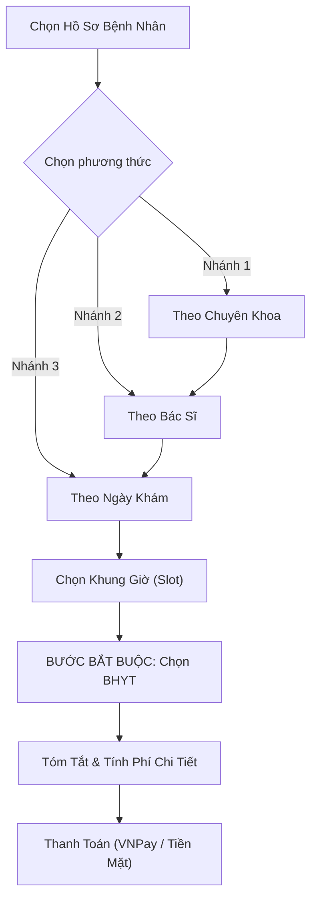

# 📱 TÀI LIỆU KIẾN TRÚC & LOGIC NGHIỆP VỤ HỆ THỐNG PATIENT-MOBILE
> **Đồ án / Khoá Luận Tốt Nghiệp: Hệ Thống Quản Lý Phòng Khám Thông Minh (Clinic Management System)**  
> **Ứng dụng:** Mobile App dành cho Bệnh nhân (`patient_mobile`)  
> **Nền tảng:** Flutter (Dart) | **Mô hình kiến trúc:** MVC / Controller-Service Pattern với GetX  

---

## MỤC LỤC
1. [TỔNG QUAN HỆ THỐNG (SYSTEM OVERVIEW)](#1-tổng-quan-hệ-thống)
2. [CÔNG NGHỆ & THƯ VIỆN CỐT LÕI (TECH STACK)](#2-công-nghệ--thư-viện-cốt-lõi)
3. [CẤU TRÚC THƯ MỤC DỰ ÁN (PROJECT STRUCTURE)](#3-cấu-trúc-thư-mục-dự-án)
4. [CHI TIẾT LOGIC NGHIỆP VỤ CÁC PHÂN HỆ CHÍNH](#4-chi-tiết-logic-nghiệp-vụ-các-phân-hệ-chính)
   - [4.1. Phân hệ Xác thực & Quản lý Tài khoản (Auth Module)](#41-phân-hệ-xác-thực--quản-lý-tài-khoản)
   - [4.2. Phân hệ Quản lý Đa Hồ Sơ Bệnh Nhân (Patient Profiles)](#42-phân-hệ-quản-lý-đa-hồ-sơ-bệnh-nhân)
   - [4.3. Phân hệ Đặt Lịch Khám & Tính Phí BHYT (Booking & Insurance Engine)](#43-phân-hệ-đặt-lịch-khám--tính-phí-bhyt)
   - [4.4. Phân hệ Thanh Toán Viện Phí (VNPay Payment Gateway)](#44-phân-hệ-thanh-toán-viện-phí)
   - [4.5. Phân hệ Check-in Điện Tử & Phiếu Khám QR (E-Ticket)](#45-phân-hệ-check-in-điện-tử--phiếu-khám-qr)
   - [4.6. Phân hệ Hàng Đợi Thời Gian Thực (Live Queue Tracker) & Push Notification](#46-phân-hệ-hàng-đợi-thời-gian-thực)
   - [4.7. Phân hệ Hồ Sơ Bệnh Án Điện Tử & Đơn Thuốc (EMR Module)](#47-phân-hệ-hồ-sơ-bệnh-án-điện-tử)
   - [4.8. Phân hệ Trợ Lý AI Y Tế Thông Minh (AI Medical Chatbot)](#48-phân-hệ-trợ-lý-ai-y-tế-thông-minh)
5. [MA TRẬN KẾT NỐI API BACKEND (API INTEGRATION MATRIX)](#5-ma-trận-kết-nối-api-backend)
6. [CƠ CHẾ BẢO MẬT & QUẢN LÝ DỮ LIỆU CỤC BỘ](#6-cơ-chế-bảo-mật--quản-lý-dữ-liệu-cục-bộ)

---

## 1. TỔNG QUAN HỆ THỐNG

Ứng dụng **`patient_mobile`** là cổng giao tiếp số (Digital Patient Portal) trong hệ sinh thái quản lý phòng khám thông minh. Ứng dụng đóng vai trò:
- Chuyển đổi toàn bộ quy trình đi khám truyền thống (bốc số giấy, xếp hàng làm hồ sơ, đóng tiền mặt, chờ nghe loa gọi) sang **quy trình y tế số khép kín (End-to-End Digital Healthcare Flow)**.
- Cho phép người bệnh chủ động đặt lịch khám theo chuyên khoa/bác sĩ/ngày giờ từ trước ở nhà.
- Tích hợp cổng thanh toán trực tuyến **VNPay Sandbox**.
- Cung cấp **Phiếu khám điện tử (E-Ticket)** với mã QR tiếp nhận tự động.
- Tính năng đột phá: **Theo dõi hàng đợi khám thời gian thực (Live Queue Tracker)** kèm thông báo đẩy tự động khi còn 2–3 số tới lượt.
- Tra cứu kết quả cận lâm sàng, chẩn đoán và đơn thuốc điện tử (EMR).
- Trợ lý ảo AI tư vấn triệu chứng sức khỏe 24/7 ứng dụng mô hình ngôn ngữ lớn (LLM).

---

## 2. CÔNG NGHỆ & THƯ VIỆN CỐT LÕI

| Nhóm công nghệ | Thư viện / Công cụ | Phiên bản | Mục đích sử dụng |
|---|---|---|---|
| **Core Framework** | Flutter SDK | `^3.11.3` | Nền tảng phát triển ứng dụng di động đa nền tảng |
| **State & Navigation** | `get` (GetX) | `^4.7.3` | Quản lý trạng thái phản ứng (Reactive State Management `Obx`), điều hướng Route không cần Context, Dependency Injection |
| **Network & REST API** | `http`, `dio` | `^1.6.0`, `^5.11.1` | Giao tiếp RESTful API với Laravel Backend, xử lý Timeout, Interceptor |
| **Push Notification** | `firebase_messaging` | `^16.7.0` | Nhận thông báo đám mây (FCM) từ server khi có sự kiện khám, tiếp nhận, hàng đợi |
| **Local Notifications** | `flutter_local_notifications` | `^22.3.1` | Hiển thị Banner/Popup thông báo nổi ngay khi ứng dụng đang mở ở Foreground |
| **Mã QR Code** | `qr_flutter` | `^4.1.0` | Tạo mã QR động chuẩn hóa cho Phiếu tiếp nhận điện tử (E-Ticket) |
| **Thanh toán số** | `crypto`, `url_launcher` | `^3.0.7`, `^6.3.3` | Tạo chuỗi băm HMAC-SHA512 ký số bảo mật cho cổng VNPay và mở Webview/trình duyệt |
| **Trợ lý AI** | `google_generative_ai`, `dash_chat_2` | `^0.4.7`, `^0.0.21` | Tích hợp mô hình Gemini Pro để phân tích triệu chứng y tế và giao diện chat bong bóng hiện đại |
| **Lưu trữ bảo mật** | `flutter_secure_storage`, `shared_preferences` | `^11.2.0`, `^2.5.5` | Lưu trữ Token xác thực JWT, SĐT người dùng và bộ nhớ đệm hồ sơ bệnh nhân |

---

## 3. CẤU TRÚC THƯ MỤC DỰ ÁN

```text
lib/
├── core/
│   ├── app_colors.dart                 # Bảng màu thương hiệu (Primary Blue, Green, Amber, Gray)
│   ├── app_theme.dart                  # Cấu hình ThemeData, Typography, ButtonStyle
│   └── constants/
│       └── api_constants.dart          # Địa chỉ máy chủ Backend (IP tĩnh, Endpoint base)
├── firebase_options.dart               # Cấu hình chứng thực dịch vụ Firebase
├── main.dart                           # Khởi tạo App, Firebase, Local Notifications, GetMaterialApp
├── screens/
│   ├── auth/                           # Đăng nhập, Đăng ký, Quên mật khẩu, Xác thực OTP
│   ├── booking/                        # Luồng đặt lịch khám toàn diện
│   │   ├── controllers/
│   │   │   └── booking_controller.dart # Trái tim logic đặt khám, giỏ khám, tính BHYT
│   │   ├── views/
│   │   │   ├── specialty_screen.dart   # Chọn chuyên khoa & xem giá khám thực tế
│   │   │   ├── doctor_list_screen.dart # Danh sách bác sĩ theo khoa / kinh nghiệm / phòng khám
│   │   │   ├── date_selection_screen.dart # Lịch chọn ngày khám
│   │   │   ├── time_slot_screen.dart   # Khung giờ trống (Slot) của bác sĩ
│   │   │   ├── insurance_screen.dart   # Bắt buộc chọn mức BHYT (Đúng tuyến / Trái tuyến / Không)
│   │   │   ├── summary_screen.dart     # Tóm tắt chi phí minh bạch & Chọn phương thức thanh toán
│   │   │   ├── payment_pending_screen.dart # Chờ thanh toán VNPay
│   │   │   ├── booking_success_screen.dart # Check-in thành công & Xuất mã QR E-Ticket
│   │   │   └── e_ticket_screen.dart    # Phiếu khám điện tử + Live Queue Tracker
│   │   └── widgets/
│   ├── chatbot/                        # Trợ lý ảo AI tư vấn sức khỏe thông minh
│   ├── emr/                            # Bệnh án điện tử, Lịch sử khám bệnh, Đơn thuốc số
│   ├── home/                           # Trang chủ, UpcomingAppointmentCard, FeatureGrid, Thông báo
│   ├── main/                           # Bottom Navigation Bar điều hướng các tab chính
│   ├── payment/                        # Quản lý viện phí, danh sách hóa đơn
│   └── profile/                        # Quản lý đa hồ sơ bệnh nhân (bản thân & người thân)
├── services/
│   ├── auth_service.dart               # Quản lý phiên đăng nhập, JWT token, User state
│   ├── booking_api_service.dart        # API gọi bác sĩ, chuyên khoa, đặt lịch, hàng đợi
│   ├── emr_service.dart                # API bệnh án, lịch sử khám, đơn thuốc
│   ├── fcm_service.dart                # Xử lý thông báo đẩy Firebase & Local Popups
│   ├── patient_profile_service.dart    # Đồng bộ & Cache hồ sơ người bệnh
│   └── vnpay_service.dart              # Xây dựng URL thanh toán VNPay Sandbox
└── widgets/
    └── live_queue_tracker_widget.dart  # Widget theo dõi tiến trình hàng đợi thời gian thực
```

---

## 4. CHI TIẾT LOGIC NGHIỆP VỤ CÁC PHÂN HỆ CHÍNH

### 4.1. Phân hệ Xác thực & Quản lý Tài khoản (Auth Module)
- **Cơ chế xác thực:** Sử dụng số điện thoại làm định danh duy nhất (Unique Identity). Hỗ trợ đăng nhập qua Mật khẩu hoặc OTP.
- **Quản lý Token:** Lưu trữ JWT Token bảo mật trong `flutter_secure_storage`. Mọi request API đến Backend đều tự động gắn Header `Authorization: Bearer <token>`.
- **Đồng bộ FCM Token:** Ngay khi đăng nhập thành công, app tự động lấy `fcm_token` từ Firebase Messaging và gọi `AuthService().updateFcmToken(phone, token)` đẩy lên Database bảng `users` để server có thể gửi Push Notification khi có sự kiện.

---

### 4.2. Phân hệ Quản lý Đa Hồ Sơ Bệnh Nhân (Patient Profiles)
Trong thực tế y tế gia đình, một tài khoản ứng dụng (bố/mẹ) thường quản lý khám cho nhiều thành viên (con cái, ông bà).
- **Mô hình 1 - N:** Một tài khoản `TaiKhoan` gắn với nhiều `HoSoBenhAn` (Mã hồ sơ riêng biệt, CCCD, nhóm máu, tiền sử dị ứng).
- **Bộ nhớ đệm (Cache Service):** `PatientProfileService` tải danh sách hồ sơ khi khởi động và lưu trữ vào `cachedProfiles`.
- **Validation trước đặt khám:** Bệnh nhân bắt buộc phải chọn hoặc tạo ít nhất một hồ sơ hợp lệ trước khi tiến hành chọn bác sĩ/chuyên khoa.
- **Hệ thống dữ liệu hành chính & Nhân khẩu học thực tế đa quốc gia (Multi-country Administrative Cascading):**
  - **Quốc gia:** Danh mục đầy đủ các quốc gia trên thế giới được sắp xếp chuẩn từ **A đến Z** (Việt Nam, Trung Quốc, Hoa Kỳ, Nhật Bản, Hàn Quốc, Đài Loan, Úc, Anh, Pháp, Canada, Singapore, Thái Lan, Lào, Campuchia, v.v.), không sử dụng mục "Khác".
  - **Tỉnh / Thành phố phân cấp theo Quốc gia (Country-driven Cascading):**
    - Khi chọn **Việt Nam**: Tự động hiển thị toàn bộ **63 tỉnh, thành phố** Việt Nam sắp xếp chuẩn từ A đến Z (An Giang, Bà Rịa - Vũng Tàu, Bạc Liêu ... TP. Hồ Chí Minh ... Yên Bái).
    - Khi chọn **Trung Quốc (China)**: Tự động lọc danh sách các tỉnh, thành phố trực thuộc và khu tự trị của Trung Quốc sắp xếp chuẩn A-Z (Bắc Kinh, Thượng Hải, Quảng Châu, Thâm Quyến, Trùng Khánh, Tứ Xuyên, Hồ Bắc / Vũ Hán, Chiết Giang, Giang Tô, Hồng Kông, Ma Cao, v.v.).
    - Khi chọn **Hoa Kỳ (Mỹ)**: Tự động lọc các tiểu bang của Mỹ sắp xếp chuẩn A-Z (California, New York, Texas, Florida, Washington, Illinois, v.v.).
    - Khi chọn **Nhật Bản, Hàn Quốc, Úc, Canada, Pháp, Đức, Anh, v.v.**: Tự động lọc các tỉnh / đô thị / bang tương ứng chuẩn A-Z.
  - **Quận / Huyện (Cascading Dropdown):** Tự động lọc theo Tỉnh/Thành phố và Quốc gia đã chọn, sắp xếp chuẩn từ A đến Z (ví dụ: Chọn *Trung Quốc* $\rightarrow$ *Bắc Kinh* $\rightarrow$ hiện *Quận Triều Dương, Hải Điến, Đông Thành, Tây Thành...*; Chọn *Việt Nam* $\rightarrow$ *TP. Hồ Chí Minh* $\rightarrow$ hiện *Quận 1, Quận 3, TP. Thủ Đức, Bình Thạnh...*).
  - **Phường / Xã / Thị trấn (Cascading Dropdown):** Tự động lọc theo Quận/Huyện đã chọn, sắp xếp chuẩn từ A đến Z.
  - **Dân tộc:** Đầy đủ **54 dân tộc Việt Nam** sắp xếp chuẩn từ A đến Z (Ba Na, Bố Y, Brâu ... Kinh ... Xtiêng), không chứa mục "Khác".
  - **Nghề nghiệp & Mối quan hệ:** Danh mục chuẩn ngành y tế sắp xếp chuẩn từ A đến Z, không chứa mục "Khác".
  - **Đồng bộ cơ sở dữ liệu:** Cột `quan_huyen` đã được bổ sung vào bảng `ho_so_benh_an` qua migration và tự động chuẩn hóa ghép chuỗi vào địa chỉ thường trú của bệnh nhân.

---

### 4.3. Phân hệ Đặt Lịch Khám & Tính Phí BHYT (Booking & Insurance Engine)

#### A. Kiến trúc 3 nhánh đặt lịch linh hoạt (Booking Methods)
Người bệnh có thể bắt đầu từ bất kỳ điểm nào:


#### B. Giá khám thực tế theo chuyên khoa (Dynamic Pricing)
- Không còn hardcode giá cố định 150.000đ.
- Cột `gia_kham` từ bảng `ChuyenKhoa` được trả về qua API:
  - **Tim mạch:** 200.000đ
  - **Nội tổng hợp:** 150.000đ
  - **Da liễu:** 120.000đ
  - Các chuyên khoa đặc thù khác có giá riêng biệt.

#### C. Động cơ tính giảm trừ BHYT theo Luật BHYT Việt Nam (Sửa đổi 2024)
Bệnh nhân **bắt buộc chọn 1 trong 3 mức** tại [`insurance_screen.dart`](file:///d:/Data/Khoa%20Luan%20Tot%20Nghiep/Clinic_Management_System/patient_mobile/lib/screens/booking/views/insurance_screen.dart):
1. **Đúng tuyến (Có giấy chuyển viện / Cấp cứu / Nơi ĐK KCB ban đầu):** BHYT chi trả **80%** $\rightarrow$ Bệnh nhân trả **20%**.
2. **Trái tuyến (Khám vượt tuyến tỉnh/chuyên khoa):** BHYT chi trả **60%** $\rightarrow$ Bệnh nhân trả **40%**.
3. **Không có BHYT (Khám dịch vụ tự nguyện):** BHYT chi trả **0%** $\rightarrow$ Bệnh nhân trả **100%**.

#### D. Thuật toán tính tiền trong [`booking_controller.dart`](file:///d:/Data/Khoa%20Luan%20Tot%20Nghiep/Clinic_Management_System/patient_mobile/lib/screens/booking/controllers/booking_controller.dart):
$$\text{Tiền khám gốc} = \sum \text{gia\_kham của các chuyên khoa đã chọn}$$
$$\text{Tiền BHYT chi trả} = \text{Tiền khám gốc} \times \text{Tỷ lệ BHYT (0.80 / 0.60 / 0.00)}$$
$$\text{Số tiền thực thanh toán} = \text{Tiền khám gốc} - \text{Tiền BHYT chi trả}$$

---

### 4.4. Phân hệ Thanh Toán Viện Phí (VNPay Payment Gateway)
- **Phương thức tại quầy:** Bệnh nhân nhận lịch với trạng thái `da_thanh_toan` (sau khi quét QR lễ tân) hoặc thanh toán tiền mặt lúc đến viện.
- **Phương thức VNPay:**
  - Ứng dụng gửi `ma_luot_kham` và `amount` (số tiền thực thanh toán sau khi trừ BHYT) tới Endpoint `/api/vnpay/payment-url`.
  - Backend ký số bằng thuật toán `HmacSHA512` kết hợp `vnp_HashSecret` để tạo URL cổng thanh toán Sandbox.
  - Sau khi người dùng thanh toán trên cổng VNPay, callback webhook tự động cập nhật trạng thái hóa đơn sang `DaThanhToan` và lượt khám sang `da_thanh_toan`.
  - Điện thoại tự động nhận thông báo nổi xác nhận thanh toán thành công và mở khóa mã QR tiếp nhận.

---

### 4.5. Phân hệ Check-in Điện Tử & Phiếu Khám QR (E-Ticket)
- Khi thanh toán hoàn tất, app tự động tạo mã QR chứa chuỗi định danh:
  `http://<SERVER_IP>:8000/api/luot-kham/<ma_luot_kham>/tiep-nhan`
- **Quy trình tại viện:**
  1. Người bệnh đến quầy lễ tân hoặc Kiosk tự phục vụ.
  2. Máy quét barcode quét mã QR trên màn hình điện thoại.
  3. API tự động đổi trạng thái lượt khám sang `cho_kham`.
  4. Màn hình điện thoại tự động chuyển sang giao diện **"ĐÃ TIẾP NHẬN"** qua cơ chế Polling 3s mà không cần người bệnh tự bấm F5 hay tải lại trang.

---

### 4.6. Phân hệ Hàng Đợi Thời Gian Thực (Live Queue Tracker) & Push Notification
Tính năng giải quyết triệt để vấn đề thời gian chờ đợi tại cơ sở khám chữa bệnh.

```text
┌────────────────────────────────────────────────────────┐
│  🟢 HÀNG ĐỢI TRỰC TIẾP          [Phòng 102 - Lầu 1 A]  │
├──────────────────────────┬─────────────────────────────┤
│    Số thứ tự của bạn     │        Đang phục vụ         │
│          [ 18 ]          │           [ 15 ]            │
│       LƯỢT CỦA BẠN       │         ▶ ĐANG KHÁM         │
├──────────────────────────┴─────────────────────────────┤
│  Tiến trình: 15/18                    Còn 3 số nữa     │
│  ████████████████████████████░░░░                      │
├────────────────────────────────────────────────────────┤
│  ⏱ Ước tính thời gian chờ:           ~10 - 15 phút     │
├────────────────────────────────────────────────────────┤
│  🔔 SẮP ĐẾN LƯỢT KHÁM CỦA BẠN!                         │
│  Vui lòng có mặt trước cửa Phòng 102 - Lầu 1 Khu A.   │
└────────────────────────────────────────────────────────┘
```

#### A. Đồng bộ dữ liệu thật 100% từ Database
- **Cột `so_thu_tu`:** Được ghi nhận cố định vào MySQL ngay khi đặt lịch online thành công.
- **Số đang phục vụ (`dang_phuc_vu`):** Lấy theo lượt khám có `trang_thai = 'dang_kham'` hoặc lượt hoàn thành gần nhất của bác sĩ hôm đó.
- **Ước tính thời gian chờ:**
  $$\text{Số người chờ} = \text{STT của bạn} - \text{Số đang phục vụ}$$
  $$\text{Thời gian chờ} = \text{Số người chờ} \times 4\text{ đến } 5\text{ phút/ca}$$

#### B. Cơ chế Cảnh báo Sớm (Early Warning Notification)
- Khi khoảng cách hàng đợi **chỉ còn 2–3 số** (`so_nguoi_cho <= 3`):
  - Khối widget chuyển sang màu vàng hổ phách cảnh báo.
  - Server tự động bắn **FCM Push Notification** trực tiếp về điện thoại người bệnh:
    > *"🔔 Sắp đến lượt bạn! Hiện tại phòng khám đang phục vụ số 15. Vui lòng có mặt trước cửa Phòng khám 102."*
  - Bệnh nhân có đủ 10–15 phút thong thả di chuyển từ căng tin/phòng chờ về trước cửa phòng khám mà không sợ bị lỡ lượt.

#### C. Tích hợp đa màn hình
- Tích hợp trực tiếp trên thẻ **`UpcomingAppointmentCard`** ở Trang chủ.
- Tích hợp toàn diện trên màn hình **`ETicketScreen`**.
- Tích hợp ngay trên màn hình hoàn tất đặt khám **`BookingSuccessScreen`**.

---

### 4.7. Phân hệ Hồ Sơ Bệnh Án Điện Tử & Đơn Thuốc (EMR Module)
- **Bệnh án điện tử:** Xem lịch sử các lần khám bệnh trong quá khứ theo từng hồ sơ bệnh nhân.
- **Chẩn đoán & Lời khuyên:** Hiển thị kết luận chẩn đoán của bác sĩ sau khi ca khám hoàn thành (`chan_doan`, `loi_khuyen`).
- **Đơn thuốc số:** Xem danh sách thuốc kê đơn gồm tên thuốc, số lượng, hướng dẫn cách uống theo từng bữa trong ngày.

---

### 4.8. Phân hệ Trợ Lý AI Y Tế Thông Minh (AI Medical Chatbot)
- Tích hợp thư viện `google_generative_ai` kết nối mô hình Google Gemini.
- Đóng vai trò trợ lý sàng lọc triệu chứng ban đầu: Bệnh nhân nhập triệu chứng (đau đầu, sốt, phát ban), AI phân tích và đưa ra gợi ý nên đăng ký khám chuyên khoa nào phù hợp trong ứng dụng.
- Lưu trữ lịch sử đoạn hội thoại cục bộ để người dùng có thể xem lại tư vấn.

---

## 5. MA TRẬN KẾT NỐI API BACKEND

| Phân hệ | Phương thức | Endpoint | Chức năng nghiệp vụ |
|---|---|---|---|
| **Chuyên khoa** | `GET` | `/api/chuyen-khoa` | Lấy danh sách chuyên khoa kèm giá khám thực tế (`gia_kham`) |
| **Giờ trống** | `GET` | `/api/luot-kham/gio-trong?ma_bac_si={id}&ngay_kham={date}` | Kiểm tra khung giờ trống chưa có người đặt của bác sĩ |
| **Đặt lịch** | `POST` | `/api/luot-kham/dat-lich` | Tạo lượt khám mới, kiểm tra race condition, cấp STT cố định |
| **Danh sách khám** | `POST` | `/api/luot-kham/danh-sach` | Lấy danh sách lịch hẹn của các hồ sơ bệnh nhân |
| **Tiếp nhận QR** | `PUT/POST/GET`| `/api/luot-kham/{id}/tiep-nhan` | Lễ tân quét mã QR check-in, đổi trạng thái sang `cho_kham` |
| **Trạng thái khám** | `GET` | `/api/luot-kham/{id}/check-status` | Polling kiểm tra trạng thái thanh toán và check-in |
| **Live Queue** | `GET` | `/api/luot-kham/{id}/hang-doi` | Lấy tiến trình hàng đợi: STT của bạn, Đang phục vụ, Ước tính chờ |
| **Push Alert** | `POST` | `/api/luot-kham/{id}/thong-bao-sap-den-luot` | Kích hoạt bắn Push Notification khi còn 2-3 số |
| **VNPay Sandbox**| `GET` | `/api/vnpay/payment-url` | Tạo đường dẫn thanh toán VNPay có ký băm SHA-512 |
| **FCM Token** | `POST` | `/api/user/fcm-token` | Lưu token thiết bị để nhận thông báo đẩy |

---

## 6. CƠ CHẾ BẢO MẬT & QUẢN LÝ DỮ LIỆU CỤC BỘ

1. **Bảo mật giao dịch thanh toán:**
   - Không lưu trữ thông tin thẻ ngân hàng của bệnh nhân trên điện thoại.
   - Số tiền thanh toán được đối soát chéo trên Backend trước khi tạo chữ ký số `vnp_SecureHash`.
2. **Xử lý Race Condition khi đặt trùng khung giờ:**
   - Backend sử dụng Database Transaction kết hợp khóa dòng `lockForUpdate()` trên bảng `luot_kham`, đảm bảo không thể có 2 bệnh nhân đặt cùng 1 bác sĩ trong cùng 1 khung giờ 30 phút.
3. **Cơ chế tải ngầm & Polling nhẹ (Lightweight Polling):**
   - Polling trạng thái hàng đợi và check-in sử dụng chu kỳ 5–6 giây với Timeout 5 giây, chỉ tải các trường dữ liệu cần thiết (JSON nhẹ ~200 bytes) giúp ứng dụng hoạt động mượt mà, không nóng máy và tiết kiệm pin tối đa.
