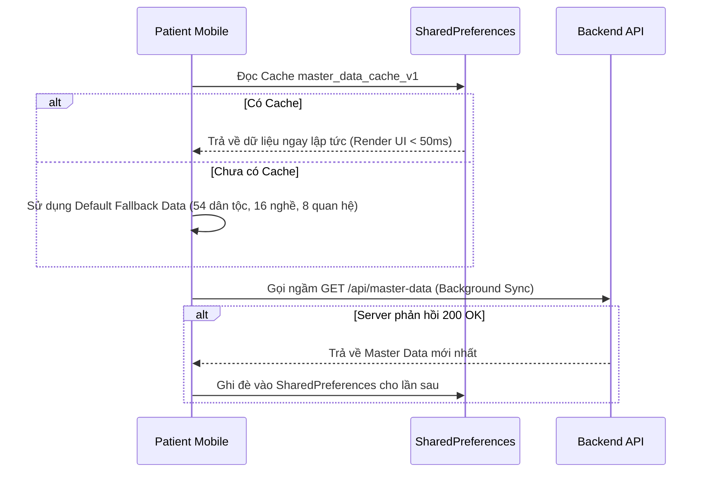
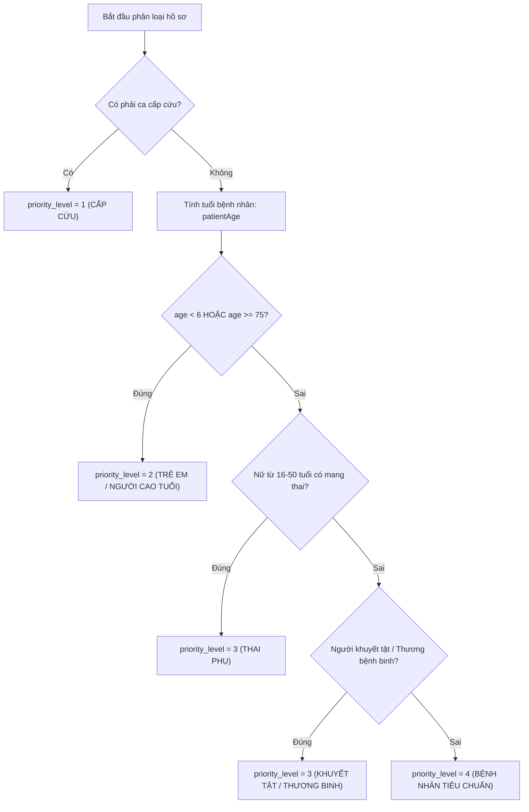
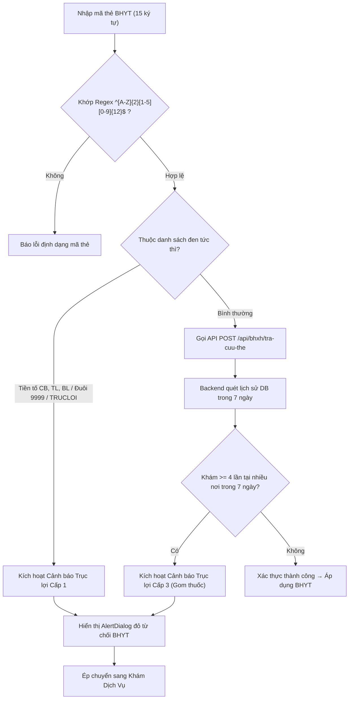

# 📱 TÀI LIỆU KIẾN TRÚC, LOGIC NGHIỆP VỤ & THUẬT TOÁN HỆ THỐNG PATIENT-MOBILE
> **Đồ án / Khoá Luận Tốt Nghiệp: Hệ Thống Quản Lý Phòng Khám Thông Minh (Clinic Management System)**  
> **Ứng dụng:** Mobile App dành cho Bệnh nhân (`patient_mobile`)  
> **Nền tảng:** Flutter (Dart) | **Mô hình kiến trúc:** MVC / Controller-Service Pattern với GetX  
> **Backend:** Laravel 11 (PHP 8.3) RESTful API  
> **Cơ sở dữ liệu:** MySQL (`QuanLyKhamChuaBenh`)  
> **Cập nhật toàn diện:** 2026-11-09

---

## MỤC LỤC
1. [TỔNG QUAN HỆ THỐNG (SYSTEM OVERVIEW)](#1-tổng-quan-hệ-thống)
2. [CÔNG NGHỆ & THƯ VIỆN CỐT LÕI (TECH STACK)](#2-công-nghệ--thư-viện-cốt-lõi)
3. [CẤU TRÚC THƯ MỤC DỰ ÁN (PROJECT STRUCTURE)](#3-cấu-trúc-thư-mục-dự-án)
4. [CHI TIẾT LOGIC NGHIỆP VỤ & THUẬT TOÁN CÁC PHÂN HỆ CHÍNH](#4-chi-tiết-logic-nghiệp-vụ--thuật-toán-các-phân-hệ-chính)
   - [4.1. Phân hệ Xác thực & Quản lý Phiên Người Dùng (Auth Module)](#41-phân-hệ-xác-thực--quản-lý-phiên-người-dùng)
   - [4.2. Phân hệ Quản lý Đa Hồ Sơ & Địa Chính Đa Cấp (Patient Profiles & Master Data)](#42-phân-hệ-quản-lý-đa-hồ-sơ--địa-chính-đa-cấp)
   - [4.3. Phân hệ Đặt Lịch Khám & Chống Tranh Chấp Khung Giờ (Booking Concurrency Engine)](#43-phân-hệ-đặt-lịch-khám--chống-tranh-chấp-khung-giờ)
   - [4.4. Phân hệ Phân Tầng Ưu Tiên Y Tế Thông Minh (Smart Priority Algorithm)](#44-phân-hệ-phân-tầng-ưu-tiên-y-tế-thông-minh)
   - [4.5. Phân hệ Động Cơ Tính Phí BHYT & Miễn Đồng Chi Trả (Health Insurance Engine)](#45-phân-hệ-động-cơ-tính-phí-bhyt--miễn-đồng-chi-trả)
   - [4.6. Phân hệ Giám Định BHYT Quốc Gia & Chống Trục Lợi Gom Thuốc (Fraud Detection Gateway)](#46-phân-hệ-giám-định-bhyt-quốc-gia--chống-trục-lợi-gom-thuốc)
   - [4.7. Phân hệ Thanh Toán Viện Phí VNPay & Chữ Ký Số HMAC-SHA512 (Payment Gateway)](#47-phân-hệ-thanh-toán-viện-phí-vnpay--chữ-ký-số-hmac-sha512)
   - [4.8. Phân hệ Tiếp Nhận Tự Động & Phiếu Khám QR Điện Tử (Digital E-Ticket Check-in)](#48-phân-hệ-tiếp-nhận-tự-động--phiếu-khám-qr-điện-tử)
   - [4.9. Phân hệ Hàng Đợi Thời Gian Thực & Cảnh Báo Sớm (Live Queue Tracker & FCM Push Alert)](#49-phân-hệ-hàng-đợi-thời-gian-thực--cảnh-báo-sớm)
   - [4.10. Phân hệ Hồ Sơ Bệnh Án Điện Tử & Đơn Thuốc (EMR & Prescriptions)](#410-phân-hệ-hồ-sơ-bệnh-án-điện-tử--đơn-thuốc)
   - [4.11. Phân hệ Trợ Lý AI Chuyên Sâu Giải Thích Kết Quả CLS (Medical AI Explainer Streaming)](#411-phân-hệ-trợ-lý-ai-chuyên-sâu-giải-thích-kết-quả-cls)
5. [MA TRẬN KẾT NỐI API BACKEND (API INTEGRATION MATRIX)](#5-ma-trận-kết-nối-api-backend)
6. [CƠ CHẾ BẢO MẬT & QUẢN LÝ DỮ LIỆU CỤC BỘ](#6-cơ-chế-bảo-mật--quản-lý-dữ-liệu-cục-bộ)

---

## 1. TỔNG QUAN HỆ THỐNG

Ứng dụng **`patient_mobile`** là cổng giao tiếp số (Digital Patient Portal) trong hệ sinh thái quản lý phòng khám thông minh. Ứng dụng đóng vai trò:
- Chuyển đổi toàn bộ quy trình đi khám truyền thống (bốc số giấy, xếp hàng làm hồ sơ, đóng tiền mặt, chờ nghe loa gọi) sang **quy trình y tế số khép kín (End-to-End Digital Healthcare Flow)**.
- Cho phép người bệnh chủ động đặt lịch khám theo chuyên khoa/bác sĩ/ngày giờ từ trước ở nhà.
- Phân luồng rõ ràng **Khám Dịch Vụ** vs **Khám BHYT** ngay từ đầu quy trình đặt lịch.
- Động cơ tính phí BHYT thông minh chuẩn **Thông tư 22/2023 & 39/2024/TT-BYT** kèm cơ chế **Giám định BHYT Quốc gia chống trục lợi gom thuốc**.
- Tích hợp cổng thanh toán trực tuyến **VNPay Sandbox** với chuẩn mã hóa HMAC-SHA512.
- Cung cấp **Phiếu khám điện tử (E-Ticket)** với mã QR tiếp nhận tự động.
- **Hệ thống phân tầng ưu tiên y tế 4 cấp độ (Smart Priority System)** kết hợp **Hàng đợi thời gian thực (Live Queue Tracker)** kèm thông báo đẩy tự động khi còn 2–3 số tới lượt.
- Tra cứu kết quả cận lâm sàng, chẩn đoán và đơn thuốc điện tử (EMR).
- **Trợ lý AI giải thích kết quả xét nghiệm** (Streaming real-time, multi-model fallback, powered by Gemini).
- Trợ lý ảo AI tư vấn triệu chứng sức khỏe 24/7 ứng dụng mô hình ngôn ngữ lớn (LLM).

---

## 2. CÔNG NGHỆ & THƯ VIỆN CỐT LÕI

| Nhóm công nghệ | Thư viện / Công cụ | Phiên bản | Mục đích sử dụng |
|---|---|---|---|
| **Core Framework** | Flutter SDK | `^3.11.3` | Nền tảng phát triển ứng dụng di động đa nền tảng |
| **State & Navigation** | `get` (GetX) | `^4.7.3` | Quản lý trạng thái phản ứng (Reactive State Management `Obx`), điều hướng Route không cần Context, Dependency Injection |
| **Network & REST API** | `http`, `dio` | `^1.6.0`, `^5.11.1` | Giao tiếp RESTful API với Laravel Backend, xử lý Timeout, Interceptor |
| **Push Notification** | `firebase_messaging` | `^16.7.0` | Nhận thông báo đám mây (FCM) từ server khi có sự kiện khám, tiếp nhận, hàng đợi |
| **Local Notifications** | `flutter_local_notifications` | `^22.3.1` | Hiển thị Banner/Popup thông báo nổi ngay khi ứng dụng đang mở ở Foreground |
| **Mã QR Code** | `qr_flutter` | `^4.1.0` | Tạo mã QR động chuẩn hóa cho Phiếu tiếp nhận điện tử (E-Ticket) |
| **Thanh toán số** | `crypto`, `url_launcher` | `^3.0.7`, `^6.3.3` | Tạo chuỗi băm HMAC-SHA512 ký số bảo mật cho cổng VNPay và mở Webview/trình duyệt |
| **Trợ lý AI** | `google_generative_ai`, `dash_chat_2` | `^0.4.7`, `^0.0.21` | Tích hợp mô hình Gemini để phân tích triệu chứng y tế, giải thích kết quả xét nghiệm, và giao diện chat bong bóng hiện đại |
| **Lưu trữ bảo mật** | `flutter_secure_storage`, `shared_preferences` | `^11.2.0`, `^2.5.5` | Lưu trữ Token xác thực JWT, SĐT người dùng, bộ nhớ đệm hồ sơ bệnh nhân và custom Gemini API key |

---

## 3. CẤU TRÚC THƯ MỤC DỰ ÁN

```text
lib/
├── core/
│   ├── address/                            # Phân hệ địa chỉ hành chính đa quốc gia
│   │   ├── controllers/
│   │   │   └── address_cascading_controller.dart  # GetX controller quản lý cascading dropdown
│   │   ├── data/
│   │   │   └── international_address_data.dart    # Dữ liệu địa chỉ: 63 tỉnh VN + tỉnh/bang 20+ quốc gia
│   │   ├── models/
│   │   │   └── administrative_unit.dart           # Model đơn vị hành chính (tỉnh, huyện, xã)
│   │   ├── repositories/
│   │   │   ├── address_repository.dart            # Repository tổng hợp tra cứu địa chỉ
│   │   │   └── vietnam_address_repository.dart    # Repository riêng cho 63 tỉnh VN
│   │   └── widgets/
│   │       └── cascading_address_picker.dart      # Widget Dropdown 4 cấp (Quốc gia → Tỉnh → Huyện → Xã)
│   ├── app_colors.dart                     # Bảng màu thương hiệu (Primary Blue, Green, Amber, Gray)
│   ├── app_theme.dart                      # Cấu hình ThemeData, Typography, ButtonStyle
│   └── constants/
│       └── api_constants.dart              # Địa chỉ máy chủ Backend (IP tĩnh, Endpoint base)
├── firebase_options.dart                   # Cấu hình chứng thực dịch vụ Firebase
├── main.dart                               # Khởi tạo App, Firebase, Local Notifications, GetMaterialApp
├── screens/
│   ├── auth/                               # Đăng nhập, Đăng ký, Quên mật khẩu, Xác thực OTP
│   │   ├── login_screen.dart
│   │   ├── register_phone_screen.dart      # Đăng ký bằng SĐT + Firebase OTP
│   │   ├── set_password_screen.dart
│   │   └── verify_otp_screen.dart
│   ├── booking/                            # Luồng đặt lịch khám toàn diện
│   │   ├── booking_screen.dart             # Entry point: phân luồng Dịch vụ vs BHYT
│   │   ├── controllers/
│   │   │   └── booking_controller.dart     # Trái tim logic đặt khám, giỏ khám, tính BHYT, ưu tiên
│   │   ├── views/
│   │   │   ├── specialty_screen.dart       # Chọn chuyên khoa & xem giá khám thực tế
│   │   │   ├── doctor_list_screen.dart     # Danh sách bác sĩ theo khoa / kinh nghiệm / phòng khám
│   │   │   ├── date_selection_screen.dart  # Lịch chọn ngày khám
│   │   │   ├── time_slot_screen.dart       # Khung giờ trống (Slot) của bác sĩ
│   │   │   ├── insurance_screen.dart       # Chọn loại BHYT & nhập mã thẻ
│   │   │   ├── select_profile_screen.dart  # Chọn hồ sơ bệnh nhân trước khi đặt lịch
│   │   │   ├── summary_screen.dart         # Tóm tắt chi phí minh bạch & chọn thanh toán
│   │   │   ├── review_summary_screen.dart  # Màn hình xem lại thông tin đặt khám (read-only)
│   │   │   ├── payment_pending_screen.dart # Chờ thanh toán VNPay
│   │   │   ├── booking_success_screen.dart # Check-in thành công & Xuất mã QR E-Ticket
│   │   │   ├── e_ticket_screen.dart        # Phiếu khám điện tử + Live Queue Tracker
│   │   │   └── appointment_list_screen.dart# Danh sách tất cả lịch hẹn của bệnh nhân
│   │   └── widgets/
│   │       ├── advanced_doctor_card.dart   # Card bác sĩ nâng cao (ảnh, học hàm, kinh nghiệm)
│   │       ├── confirmation_step.dart      # Widget bước xác nhận trong stepper
│   │       ├── doctor_card.dart            # Card bác sĩ cơ bản
│   │       ├── doctor_selection_step.dart  # Widget bước chọn bác sĩ
│   │       ├── step_indicator.dart         # Thanh tiến trình các bước đặt lịch
│   │       ├── time_selection_step.dart    # Widget bước chọn giờ
│   │       └── time_slot_grid.dart         # Lưới khung giờ trống
│   ├── chatbot/                            # Trợ lý ảo AI tư vấn sức khỏe thông minh
│   │   ├── chatbot_controller.dart
│   │   └── chatbot_screen.dart
│   ├── emr/                               # Bệnh án điện tử, Lịch sử khám bệnh, Đơn thuốc số
│   │   ├── emr_screen.dart
│   │   └── widgets/
│   │       ├── medical_ai_explainer_sheet.dart  # BottomSheet giải thích kết quả XN bằng AI (Streaming)
│   │       ├── test_results_tab.dart            # Tab kết quả cận lâm sàng + nút "Hỏi AI"
│   │       ├── visit_detail_screen.dart         # Chi tiết lượt khám: chẩn đoán, đơn thuốc, XN
│   │       ├── visit_history_tab.dart           # Tab lịch sử khám bệnh theo thời gian
│   │       └── visit_timeline_item.dart         # Item timeline một lượt khám
│   ├── home/                               # Trang chủ, UpcomingAppointmentCard, FeatureGrid, Thông báo
│   │   ├── home_screen.dart
│   │   ├── notification_screen.dart        # Trung tâm thông báo
│   │   ├── controllers/
│   │   │   ├── home_controller.dart
│   │   │   └── notification_controller.dart
│   │   └── widgets/
│   │       ├── custom_header.dart          # Header chào mừng + tên bệnh nhân
│   │       ├── feature_grid.dart           # Lưới tính năng chính (Đặt lịch, EMR, AI Chat…)
│   │       ├── patient_id_card.dart        # Thẻ ID bệnh nhân với QR icon
│   │       └── upcoming_appointment_card.dart  # Thẻ lịch hẹn gần nhất + Live Queue mini
│   ├── main/                               # Bottom Navigation Bar điều hướng các tab chính
│   │   └── main_screen.dart
│   ├── payment/                            # Quản lý viện phí, danh sách hóa đơn
│   │   ├── payment_screen.dart
│   │   ├── PaymentScreen.dart
│   │   ├── PaymentTabController.dart
│   │   └── controllers/
│   │       └── payment_tab_controller.dart
│   └── profile/                            # Quản lý đa hồ sơ bệnh nhân (bản thân & người thân)
│       ├── change_password_screen.dart
│       ├── create_profile_screen.dart      # Tạo mới hồ sơ với Cascading Address Picker
│       ├── personal_info_screen.dart
│       ├── profile_empty_screen.dart       # Màn hình khi chưa có hồ sơ nào
│       ├── search_profile_screen.dart
│       ├── user_profile_screen.dart
│       └── widgets/
│           └── profile_type_bottom_sheet.dart  # BottomSheet chọn loại hồ sơ (bản thân / người thân)
├── services/
│   ├── auth_service.dart                   # Quản lý phiên đăng nhập, JWT token, User state
│   ├── booking_api_service.dart            # API gọi bác sĩ, chuyên khoa, đặt lịch, hàng đợi
│   ├── emr_service.dart                    # API bệnh án, lịch sử khám, đơn thuốc, kết quả XN
│   ├── fcm_service.dart                    # Xử lý thông báo đẩy Firebase & Local Popups
│   ├── master_data_service.dart            # Tải & cache master data (dân tộc, nghề nghiệp, quốc gia) — Cache-First
│   ├── medical_ai_service.dart             # Dịch vụ AI chuyên biệt: giải thích kết quả XN (Streaming Gemini)
│   ├── patient_profile_service.dart        # Đồng bộ & Cache hồ sơ người bệnh
│   └── vnpay_service.dart                  # Xây dựng URL thanh toán VNPay Sandbox
└── widgets/
    └── live_queue_tracker_widget.dart      # Widget theo dõi tiến trình hàng đợi thời gian thực
```

---

## 4. CHI TIẾT LOGIC NGHIỆP VỤ & THUẬT TOÁN CÁC PHÂN HỆ CHÍNH

### 4.1. Phân hệ Xác thực & Quản lý Phiên Người Dùng (Auth Module)

#### A. Thuật toán chuẩn hóa định danh Số Điện Thoại
Trong hệ thống, một số điện thoại có thể tồn tại ở 2 định dạng: quốc nội (`0xxxxxxxxx`) và quốc tế (`+84xxxxxxxxx`). Thuật toán chuẩn hóa 2 chiều:

```text
Input: Phone P
If P starts with "+84" Then:
    CleanPhone = "0" + P.substring(3)
    IntlPhone  = P
Else If P starts with "0" Then:
    CleanPhone = P
    IntlPhone  = "+84" + P.substring(1)
End If
```

Khi truy vấn tài khoản hoặc đồng bộ bệnh nhân, Backend đối chiếu:
$$\text{WHERE phone\_number IN (P, CleanPhone, IntlPhone)}$$

#### B. Cơ chế bảo mật JWT & Đồng bộ FCM Token
1. **Lưu trữ bảo mật:** JWT Token được mã hóa lưu trong Android Keystore / iOS Keychain thông qua thư viện `flutter_secure_storage`.
2. **HTTP Interceptor:** Mọi request đều tự động gắn Header:
   `Authorization: Bearer <JWT_TOKEN>`
3. **Đồng bộ FCM Token:** Ngay khi xác thực thành công, client gọi `FirebaseMessaging.instance.getToken()` và gửi lên endpoint `POST /api/user/fcm-token`. CSDL lưu `fcm_token` vào bảng `users` phục vụ tính năng gửi thông báo hàng đợi thời gian thực.

---

### 4.2. Phân hệ Quản lý Đa Hồ Sơ & Địa Chính Đa Cấp (Patient Profiles & Master Data)

#### A. Mô hình Quản lý 1 - N (Tài khoản - Nhiều Hồ Sơ)
Một tài khoản ứng dụng (`TaiKhoan` gắn với SĐT cha/mẹ) quản lý nhiều `HoSoBenhAn` (con cái, ông bà). Mỗi hồ sơ lưu trữ định danh y tế riêng: CCCD/Mã định danh, BHYT, nhóm máu, tiền sử bệnh án.

#### B. Thuật toán Master Data Cache-First (Stale-While-Revalidate)
Nhằm đảm bảo ứng dụng **vẫn hoạt động 100% khi mất kết nối mạng**, `MasterDataService` áp dụng chiến lược Cache-First:



#### C. Thuật toán Cascading Dropdown 4 Cấp Địa Chính Đa Quốc Gia
Quy trình lựa chọn địa phương gồm 4 bước phụ thuộc:

$$\text{Quốc Gia} \longrightarrow \text{Tỉnh / Thành Phố / Bang} \longrightarrow \text{Quận / Huyện} \longrightarrow \text{Phường / Xã}$$

- Khi chọn **Việt Nam**: Hiển thị danh mục đầy đủ **63 tỉnh, thành phố**. Khi chọn tỉnh (ví dụ TP.HCM) $\rightarrow$ lọc danh sách 24 Quận/Huyện/TP. Thủ Đức $\rightarrow$ lọc các Phường/Xã trực thuộc.
- Khi chọn **Trung Quốc**: Lọc các Tỉnh/Thành phố trực thuộc chuẩn A-Z (Bắc Kinh, Thượng Hải, Quảng Châu...). Chọn Bắc Kinh $\rightarrow$ lọc Quận Triều Dương, Hải Điến...
- Khi chọn **Hoa Kỳ**: Lọc 50 tiểu bang (California, New York, Texas...).
- **Chuẩn hóa địa chỉ thường trú:**
  $$\text{Địa chỉ} = \text{Số nhà, Tên đường} + \text{, } + \text{Phường/Xã} + \text{, } + \text{Quận/Huyện} + \text{, } + \text{Tỉnh/Thành} + \text{, } + \text{Quốc gia}$$

---

### 4.3. Phân hệ Đặt Lịch Khám & Chống Tranh Chấp Khung Giờ (Booking Concurrency Engine)

#### A. Thuật toán Chia Khung Giờ & Lọc Giờ Trống (Slot Allocation Algorithm)
- Giờ làm việc phòng khám: Sáng $07:30 - 11:30$, Chiều $13:30 - 17:00$. Mỗi slot khám chuẩn kéo dài **30 phút**.
- Backend tự động đối chiếu số lượng ca đã đặt tại khung giờ đó:

```text
Algorithm: layGioTrong(ma_bac_si, ngay_kham)
1. Tự động giải phóng các lượt đặt giữ chỗ 'cho_thanh_toan' quá 15 phút:
   UPDATE luot_kham SET trang_thai = 'huy' 
   WHERE trang_thai = 'cho_thanh_toan' AND created_at <= (NOW() - 15 phút)

2. Lấy danh sách toàn bộ khung giờ làm việc: K = [07:30, 08:00, ..., 16:30]
3. Lấy số lượng đã đặt của bác sĩ trong ngày:
   BookedCounts = SELECT gio_bat_dau, COUNT(*) FROM luot_kham 
                  WHERE ma_bac_si = ? AND DATE(thoi_gian_den_kham) = ? AND trang_thai != 'huy' 
                  GROUP BY gio_bat_dau

4. Khởi tạo GioTrong = []
5. For each slot s in K:
     If (BookedCounts[s] < 1) Then:   // Mỗi bác sĩ nhận tối đa 1 người / 1 khung giờ 30p
         GioTrong.append(s)
6. Return GioTrong
```

#### B. Thuật toán Khóa Dòng Chống Race Condition (`lockForUpdate`)
Khi có 2 bệnh nhân cùng lúc bấm nút đặt khám cùng 1 bác sĩ ở cùng 1 giây:

```php
DB::transaction(function () use ($request) {
    // 1. Tự động hủy slot giữ chỗ cũ của chính bệnh nhân này ở khung giờ này (tránh tự khóa mình)
    LuotKham::where('ma_ho_so', $request->ma_ho_so)
        ->where('ma_bac_si', $request->ma_bac_si)
        ->where('thoi_gian_den_kham', $request->thoi_gian_den_kham)
        ->where('trang_thai', 'cho_thanh_toan')
        ->update(['trang_thai' => 'huy']);

    // 2. KHÓA DÒNG EXCLUSIVE LOCK: Chặn mọi transaction khác đọc ghi vào khung giờ này
    $soNguoiDaDat = LuotKham::where('ma_bac_si', $request->ma_bac_si)
        ->where('thoi_gian_den_kham', $request->thoi_gian_den_kham)
        ->where('trang_thai', '!=', 'huy')
        ->lockForUpdate()
        ->count();

    if ($soNguoiDaDat >= 1) {
        throw new Exception('Khung giờ này của bác sĩ đã có người đặt. Vui lòng chọn giờ khác.');
    }

    // 3. Tiến hành tạo lượt khám an toàn tuyệt đối
    $luotKhamMoi = LuotKham::create([...]);
});
```

---

### 4.4. Phân hệ Phân Tầng Ưu Tiên Y Tế Thông Minh (Smart Priority Algorithm)

Để giải quyết tình trạng công bằng và nhân văn trong y tế, hệ thống xây dựng mô hình thuật toán phân tầng ưu tiên 4 cấp độ:



#### A. Thuật toán tính tuổi chính xác từ ngày sinh (`patientAge`)
Do ngày sinh trong hồ sơ có thể ở dạng `yyyy-MM-dd` hoặc `dd/MM/yyyy`, thuật toán tính số tuổi tròn:

$$\text{age} = \text{now.year} - \text{dob.year}$$
$$\text{Nếu } (\text{now.month} < \text{dob.month}) \lor (\text{now.month} == \text{dob.month} \land \text{now.day} < \text{dob.day}) \implies \text{age} = \text{age} - 1$$

#### B. Ma trận đặc tả 4 cấp độ ưu tiên

| Cấp độ (`priority_level`) | Đối tượng ưu tiên | Cơ chế nhận diện | Hành vi xử lý của hệ thống |
|:---:|---|---|---|
| **Mức 1** | **Cấp cứu y tế (Emergency)** | Bác sĩ tiếp nhận khẩn cấp | Ưu tiên số 1 tuyệt đối, đưa vào phòng khám ngay lập tức |
| **Mức 2** | **Trẻ em (< 6 tuổi) & Người cao tuổi (≥ 75 tuổi)** | **Tự động 100%:** Đối chiếu ngày sinh trong hồ sơ với ngày hiện tại | Tự động gắn nhãn `ƯU TIÊN: TRẺ EM` hoặc `ƯU TIÊN: NGƯỜI CAO TUỔI`, hiển thị huy hiệu sao vàng nổi bật |
| **Mức 3** | **Phụ nữ mang thai & Người khuyết tật / Thương bệnh binh** | **Khai báo thông minh:** Checkbox "Mang thai" chỉ mở khi $\text{gender} == \text{'Nữ'} \land 16 \le \text{age} \le 50$; Checkbox khuyết tật mở cho mọi hồ sơ | Gắn nhãn `ƯU TIÊN: THAI PHỤ` hoặc `ƯU TIÊN: KHUYẾT TẬT`, xếp trước bệnh nhân thường |
| **Mức 4** | **Bệnh nhân tiêu chuẩn** | Mặc định | Xếp theo đúng thứ tự số thứ tự thông thường |

---

### 4.5. Phân hệ Động Cơ Tính Phí BHYT & Miễn Đồng Chi Trả (Health Insurance Engine)

Động cơ tính phí BHYT được xây dựng tuân thủ nghiêm ngặt **Thông tư 22/2023/TT-BYT & 39/2024/TT-BYT** của Bộ Y tế và Luật Bảo hiểm Y tế Việt Nam.

#### A. Các hằng số định mức cốt lõi
- **`GIA_KHAM_NHA_NUOC = 42.100đ`**: Mức giá khám bệnh áp dụng cho cơ sở khám chữa bệnh công lập và thanh toán BHYT.
- **`MAX_BHYT_PER_DATE = 2`**: Giới hạn tối đa 2 chuyên khoa được áp dụng BHYT trên cùng 1 ngày khám.
- **`NGUONG_HOA_DON_NHO = 379.500đ`**: Ngưỡng 15% mức lương cơ sở (theo Luật BHYT, mọi chi phí KCB dưới ngưỡng này được miễn đồng chi trả).

#### B. Thuật toán phân rã chi phí chi tiết từng chuyên khoa (`itemCostBreakdown`)

```text
Algorithm: itemCostBreakdown(items)
Khởi tạo:
- Result = []
- Map<DateString, Int> bhytSlotByDate = {}

For each item in items:
    If item.isBhyt == false Then:
        // --- KHÁM DỊCH VỤ ---
        basePrice = item.specialty.gia_kham // (VD: 200.000đ, 150.000đ)
        Cost = basePrice
        PatientPayable = Cost // LUÔN 100% GIÁ NIÊM YẾT, KHÔNG GIẢM 30% Ở BẤT KỲ LƯỢT NÀO!
        Result.append({isBhyt: false, cost: Cost, patientPayable: PatientPayable})
    
    Else:
        // --- KHÁM BHYT (ÁP GIÁ NHÀ NƯỚC: 42.100đ) ---
        dateKey = FormatDate(item.date)
        currentSlot = bhytSlotByDate[dateKey] + 1
        bhytSlotByDate[dateKey] = currentSlot
        
        If currentSlot == 1 Then:
            Rate = 1.0
            ApprovedCost = 42100 // Lượt 1 trong ngày: Quỹ BHYT duyệt 100%
        Else If currentSlot == 2 Then:
            Rate = 0.30
            ApprovedCost = round(42100 * 0.30) // Lượt 2 trong ngày: Quỹ BHYT duyệt 30% = 12.630đ
        Else:
            Rate = 0.0
            ApprovedCost = 0     // Lượt >= 3: Vượt định mức BHYT trong ngày -> Chặn!
        End If
        
        Result.append({isBhyt: true, cost: ApprovedCost, patientPayable: 0})
    End If
End For

// --- XÉT MIỄN ĐỒNG CHI TRẢ BHYT (HÓA ĐƠN NHỎ < 379.500đ) ---
bhytSubtotal = SUM(item.cost for item in Result where item.isBhyt == true)
isSmallInvoice = (bhytSubtotal < 379500)

For each item in Result where item.isBhyt == true:
    If isSmallInvoice == true Then:
        item.patientPayable = 0 // Miễn đồng chi trả 100%!
    Else:
        item.patientPayable = round(item.cost * (1 - cardBenefitRate))
    End If
End For

Return Result
```

#### C. Thuật toán xác định mức hưởng BHYT (`cardBenefitRate`)
Dựa vào **ký tự thứ 3 của mã thẻ BHYT** (chuẩn 15 ký tự):

$$R = \begin{cases} 
1.00 \text{ (100\%)} & \text{nếu ký tự thứ 3 } \in \{'1', '2', '5'\} \\
0.95 \text{ (95\%)} & \text{nếu ký tự thứ 3 } == '3' \\
0.80 \text{ (80\%)} & \text{nếu ký tự thứ 3 } == '4' \\
0.80 \text{ (80\%)} & \text{mặc định}
\end{cases}$$

#### D. Công thức tài chính tổng kết đơn đặt khám
- **Tổng chi phí tiền công khám được duyệt:**
  $$\text{bhytCostBeforeInsurance} = \sum_{i \in \text{BHYT}} \text{ApprovedCost}_i$$
- **Số tiền người bệnh thực tế phải trả:**
  $$\text{TotalBookingCost} = \sum \text{item.patientPayable}$$
  - Đối với Khám Dịch Vụ: $\text{TotalBookingCost} = \sum \text{gia\_kham}$.
  - Đối với Khám BHYT: Vì $42.100\text{đ} + 12.630\text{đ} = 54.730\text{đ} < 379.500\text{đ}$, nên **$\text{TotalBookingCost} = 0\text{đ}$**.
- **Cơ chế duyệt thanh toán tự động khi 0đ:**
  $$\text{Nếu } \text{TotalBookingCost} == 0 \implies \text{trang\_thai} = \text{'da\_thanh\_toan'}$$
  Lượt khám được chuyển thẳng sang trạng thái đã thanh toán, cấp số thứ tự và mở khóa mã QR E-Ticket ngay lập tức mà không cần qua cổng VNPay.

---

### 4.6. Phân hệ Giám Định BHYT Quốc Gia & Chống Trục Lợi Gom Thuốc (Fraud Detection Gateway)

Hệ thống tích hợp cổng giả lập kết nối trực tiếp với **Hệ thống Giám định BHYT Quốc gia**:



---

### 4.7. Phân hệ Thanh Toán Viện Phí VNPay & Chữ Ký Số HMAC-SHA512 (Payment Gateway)

#### A. Thuật toán tạo URL và băm dữ liệu HMAC-SHA512

```text
Algorithm: createVNPayPaymentUrl(ma_luot_kham, amount)
1. vnp_Amount = amount * 100
2. vnp_TxnRef = "LK_" + ma_luot_kham + "_" + Timestamp
3. inputData = {
     "vnp_Version": "2.1.0",
     "vnp_Command": "pay",
     "vnp_TmnCode": VNPAY_TMN_CODE,
     "vnp_Amount": vnp_Amount,
     "vnp_CurrCode": "VND",
     "vnp_TxnRef": vnp_TxnRef,
     "vnp_OrderInfo": "Thanh toan phi kham luot #" + ma_luot_kham,
     "vnp_ReturnUrl": VNPAY_RETURN_URL,
     "vnp_IpAddr": Client_IP,
     "vnp_CreateDate": Date("YmdHis"),
     "vnp_ExpireDate": Date("YmdHis", +15 minutes)
   }
4. Sắp xếp mảng inputData theo thứ tự bảng chữ cái alphabet (ksort).
5. Xây dựng chuỗi query và hashData:
   hashData = "key1=val1&key2=val2&..." (URL-encoded)
6. Ký số bảo mật:
   vnp_SecureHash = HMAC_SHA512(hashData, VNPAY_HASH_SECRET)
7. Return Payment_URL = Base_URL + "?" + query + "&vnp_SecureHash=" + vnp_SecureHash
```

#### B. Thuật toán đối soát Callback Webhook (Return URL)
1. Tách mã băm `vnp_SecureHash` từ request callback.
2. Tái tạo chữ ký băm từ toàn bộ các tham số bắt đầu bằng `vnp_` còn lại.
3. Đối chiếu chữ ký: Nếu trùng khớp và `vnp_ResponseCode == '00'`:
   - Trích xuất danh sách `ma_luot_kham` từ chuỗi `vnp_TxnRef`.
   - Cập nhật đồng loạt trạng thái `da_thanh_toan` cho các lượt khám.
   - Bắn thông báo đẩy **FCM Push Notification** đến SĐT người bệnh: *"Thanh toán thành công! Mã QR check-in đã sẵn sàng trên ứng dụng"*.

---

### 4.8. Phân hệ Tiếp Nhận Tự Động & Phiếu Khám QR Điện Tử (Digital E-Ticket Check-in)

- **Cấu trúc dữ liệu mã QR:**
  `http://<SERVER_IP>:8080/api/luot-kham/<ma_luot_kham>/tiep-nhan`
- **Quy trình tiếp nhận không chạm (Contactless Check-in):**
  1. Người bệnh đến quầy tiếp nhận đưa mã QR trên điện thoại trước máy quét barcode.
  2. Máy quét gọi API `PUT /api/luot-kham/{id}/tiep-nhan`, Backend đổi trạng thái lượt khám sang `cho_kham`.
  3. Màn hình điện thoại người bệnh chạy cơ chế **Polling 3 giây** (`checkStatus`). Khi phát hiện trạng thái chuyển sang `cho_kham`, giao diện tự động bật thông báo "ĐÃ TIẾP NHẬN THÀNH CÔNG" và hiển thị số phòng khám cần tới.

---

### 4.9. Phân hệ Hàng Đợi Thời Gian Thực & Cảnh Báo Sớm (Live Queue Tracker & FCM Push Alert)

```text
┌────────────────────────────────────────────────────────┐
│  🟢 HÀNG ĐỢI TRỰC TIẾP          [Phòng 102 - Lầu 1 A]  │
├────────────────────────────────────────────────────────┤
│  ⭐ ĐỐI TƯỢNG ƯU TIÊN: TRẺ EM (<6 TUỔI)                 │
├──────────────────────────┬─────────────────────────────┤
│    Số thứ tự của bạn     │        Đang phục vụ         │
│          [ 18 ]          │           [ 15 ]            │
│       LƯỢT CỦA BẠN       │         ▶ ĐANG KHÁM         │
├──────────────────────────┴─────────────────────────────┤
│  Tiến trình: 15/18                    Còn 3 số nữa     │
│  ████████████████████████████░░░░                      │
├────────────────────────────────────────────────────────┤
│  ⏱ Ước tính thời gian chờ:           ~10 - 15 phút     │
├────────────────────────────────────────────────────────┤
│  🔔 SẮP ĐẾN LƯỢT KHÁM CỦA BẠN!                         │
│  Vui lòng có mặt trước cửa Phòng 102 - Lầu 1 Khu A.   │
└────────────────────────────────────────────────────────┘
```

#### A. Thuật toán tìm số đang phục vụ (`dang_phuc_vu`)
Backend đối chiếu trạng thái thực tế trong phòng khám của bác sĩ:

$$\text{dang\_phuc\_vu} = \begin{cases}
\text{item.so\_thu\_tu} & \text{nếu có lượt khám mang } \text{trang\_thai} = \text{'dang\_kham'} \\
\min(\text{maxDoneStt} + 1, \text{sttCuaBan}) & \text{nếu có ca đã xong mang } \text{trang\_thai} = \text{'hoan\_thanh'} \\
\max(1, \text{sttCuaBan} - 3) & \text{mặc định đầu ca khám}
\end{cases}$$

#### B. Thuật toán tính số người chờ & Ước tính thời gian động (Dynamic ETA)
$$\text{so\_nguoi\_cho} = \max(0, \text{so\_thu\_tu} - \text{dang\_phuc\_vu})$$

$$\text{ETA} = \begin{cases}
\text{"Đang trong phòng khám"} & \text{nếu } \text{trang\_thai} == \text{'dang\_kham'} \\
\text{"Đã hoàn thành khám"} & \text{nếu } \text{trang\_thai} == \text{'hoan\_thanh'} \\
\text{"Đến lượt bạn ngay bây giờ!"} & \text{nếu } \text{so\_nguoi\_cho} == 0 \\
\sim (\text{so\_nguoi\_cho} \times 3 + 1) - (\text{so\_nguoi\_cho} \times 5) \text{ phút} & \text{nếu } \text{so\_nguoi\_cho} > 0
\end{cases}$$

#### C. Thuật toán Cảnh Báo Sớm Đa Kênh (Early Warning Alert)
Khi khoảng cách hàng đợi tiến vào vùng nguy cơ:

$$\text{canhBaoSapDenLuot} = (0 < \text{so\_nguoi\_cho} \le 3)$$

- Khối giao diện `LiveQueueTrackerWidget` đổi viền sang màu vàng cảnh báo (`Color(0xFFFDE68A)`).
- Chấm tròn trạng thái kích hoạt hiệu ứng đập nhịp tim `ScaleTransition` (Animation scale 0.85 - 1.15).
- Server tự động bắn **FCM Push Notification** trực tiếp về máy bệnh nhân:
  > *"🔔 Sắp đến lượt bạn! Số thứ tự: #18 (Hiện tại đang phục vụ #15). Vui lòng có mặt trước cửa Phòng 102 - Lầu 1 Khu A."*

---

### 4.10. Phân hệ Hồ Sơ Bệnh Án Điện Tử & Đơn Thuốc (EMR & Prescriptions)
- **Truy vấn liên bảng thông minh:** Backend tự động liên kết các bảng `phienkham` $\rightarrow$ `lichkham` $\rightarrow$ `donthuoc` $\rightarrow$ `chitietdonthuoc` $\rightarrow$ `thuoc` $\rightarrow$ `chidinhdichvu` $\rightarrow$ `dichvu`.
- **Hiển thị tiến trình điều trị:** Xem toàn bộ lịch sử khám bệnh theo dòng thời gian timeline, chẩn đoán sơ bộ, chẩn đoán xác định của bác sĩ.
- **Đơn thuốc điện tử:** Hiển thị chi tiết từng loại thuốc, đơn vị tính, số lượng, liều dùng và hướng dẫn cách uống theo từng bữa trong ngày.

---

### 4.11. Phân hệ Trợ Lý AI Chuyên Sâu Giải Thích Kết Quả CLS (Medical AI Explainer Streaming)

Tách biệt với Chatbot hỏi đáp thông thường, phân hệ `MedicalAiService` là dịch vụ AI chuyên biệt đọc hiểu dữ liệu lâm sàng:

#### A. Thuật toán Multi-Model Sequential Fallback
Để tránh tình trạng gián đoạn dịch vụ khi một model của Google Gemini bị nghẽn hoặc hết quota, thuật toán thử lần lượt danh sách model ưu tiên:

```text
ModelCandidates = [
    'gemini-3.5-flash-lite',  // Ưu tiên 1: Tốc độ cao, độ trễ thấp
    'gemini-3.5-flash',       // Ưu tiên 2: Cân bằng suy luận y khoa
    'gemini-flash-latest',    // Ưu tiên 3: Phiên bản ổn định mới nhất
    'gemini-3.8-flash'        // Ưu tiên 4: Fallback nâng cao
]

For each model in ModelCandidates:
    Try:
        Generate Stream Response with model
        If success -> Exit loop and return Stream
    Catch Exception:
        Continue to next model
```

#### B. Cơ chế Streaming Real-Time (Token-by-Token)
Sử dụng `Stream<String>` đẩy dữ liệu sinh chữ theo thời gian thực về `MedicalAiExplainerSheet`. Người bệnh có thể đọc ngay câu trả lời trong khi AI vẫn đang suy luận, loại bỏ hoàn toàn cảm giác phải chờ đợi xoay vòng (loading spinner).

#### C. Định dạng Prompt Chuẩn Y Khoa
Prompt ép cấu trúc câu trả lời của AI theo 4 phần rành mạch:
1. **Ý nghĩa chỉ số xét nghiệm:** Diễn giải từ ngữ chuyên môn sang ngôn ngữ đời thường, dễ hiểu.
2. **Đánh giá sơ bộ:** Nhận định chỉ số là bình thường hay bất thường.
3. **Lời khuyên thực tế:** Chế độ ăn uống, sinh hoạt, tập luyện và kiêng cữ cụ thể.
4. **Cảnh báo an toàn y tế:** Luôn nhắc nhở người bệnh tuân thủ chỉ định của bác sĩ điều trị.

---

## 5. MA TRẬN KẾT NỐI API BACKEND

| Phân hệ | Phương thức | Endpoint | Chức năng nghiệp vụ & Thuật toán liên quan |
|---|---|---|---|
| **Chuyên khoa** | `GET` | `/api/chuyen-khoa` | Lấy danh sách chuyên khoa kèm giá khám thực tế (`gia_kham`) |
| **Giờ trống** | `GET` | `/api/luot-kham/gio-trong?ma_bac_si={id}&ngay_kham={date}` | Quét giờ trống, giải phóng slot giữ chỗ quá 15 phút |
| **Đặt lịch** | `POST` | `/api/luot-kham/dat-lich` | `lockForUpdate()`, cấp STT cố định, phân loại `priority_level` |
| **Danh sách khám** | `POST` | `/api/luot-kham/danh-sach` | Lấy lịch hẹn của các hồ sơ bệnh nhân theo mảng `danh_sach_ma_ho_so` |
| **Tiếp nhận QR** | `PUT/POST/GET`| `/api/luot-kham/{id}/tiep-nhan` | Quét mã QR check-in, đổi trạng thái sang `cho_kham` |
| **Trạng thái khám** | `GET` | `/api/luot-kham/{id}/check-status` | Polling chu kỳ 3–5s kiểm tra thanh toán và tiếp nhận |
| **Live Queue** | `GET` | `/api/luot-kham/{id}/hang-doi` | Trả về STT của bạn, Đang phục vụ, Ước tính chờ, Cảnh báo sớm |
| **Push Alert** | `POST` | `/api/luot-kham/{id}/thong-bao-sap-den-luot` | Kích hoạt bắn thông báo FCM khi còn 2–3 số |
| **VNPay Sandbox**| `GET` | `/api/vnpay/payment-url` | Tạo URL thanh toán VNPay có ký băm HMAC-SHA512 |
| **VNPay Return** | `GET` | `/api/vnpay/return` | Webhook xác minh chữ ký số, cập nhật `da_thanh_toan` và bắn FCM |
| **FCM Token** | `POST` | `/api/user/fcm-token` | Lưu token thiết bị để nhận thông báo đẩy nền và nổi |
| **Hồ sơ bệnh nhân** | `GET/POST/PUT` | `/api/ho-so-benh-nhan` | Quản lý đa hồ sơ, bổ sung cột `quan_huyen` |
| **Bệnh án / EMR** | `GET` | `/api/emr/lich-su-kham` | Lấy lịch sử phiên khám, chẩn đoán, đơn thuốc |
| **Cận lâm sàng** | `GET` | `/api/emr/ket-qua-cls` | Lấy kết quả xét nghiệm CLS và giá dịch vụ |
| **BHXH Validation** | `POST/GET` | `/api/bhxh/tra-cuu-the` | Giám định BHYT Quốc gia, phát hiện trục lợi gom thuốc |

---

## 6. CƠ CHẾ BẢO MẬT & QUẢN LÝ DỮ LIỆU CỤC BỘ

1. **Bảo mật giao dịch tài chính:**
   - Không lưu bất kỳ thông tin tài khoản ngân hàng hoặc thẻ tín dụng nào trên ứng dụng điện thoại.
   - Số tiền thanh toán được Backend ký số băm bảo mật bằng thuật toán `HmacSHA512` kết hợp `vnp_HashSecret`.

2. **Kiểm soát đồng thời (Concurrency Control):**
   - Áp dụng `DB::transaction()` và khóa dòng `lockForUpdate()` trên bảng `luot_kham`, loại bỏ hoàn toàn khả năng 2 bệnh nhân đặt trùng một khung giờ 30 phút của bác sĩ.
   - Cơ chế dọn rác tự động giải phóng các lượt đặt treo `cho_thanh_toan` sau 15 phút.

3. **Cơ chế Polling nhẹ tiết kiệm tài nguyên (Smart Polling):**
   - Polling hàng đợi chu kỳ 15 giây, Polling tiếp nhận QR chu kỳ 3–5 giây.
   - Gói tin trao đổi được tối ưu hóa siêu nhẹ (JSON ~200 bytes), đảm bảo ứng dụng chạy êm ái, không nóng máy và tiết kiệm pin tối đa.

4. **Quản trị Khóa API AI An Toàn:**
   - Hỗ trợ lưu trữ khóa Custom API Key trong `SharedPreferences` cho người dùng nâng cao.
   - Fallback khóa mặc định được mã hóa Base64 trong mã nguồn giúp demo mượt mà.

5. **Khả năng hoạt động ngoại tuyến (Offline Resilience):**
   - `MasterDataService` áp dụng Cache-First: Dữ liệu 54 dân tộc, 16 nhóm nghề nghiệp, 8 mối quan hệ gia đình và danh mục quốc gia luôn sẵn sàng ngay cả khi mất mạng.
   - `AddressRepository` cung cấp sẵn bộ dữ liệu tĩnh dự phòng cho toàn bộ 63 tỉnh thành Việt Nam.
