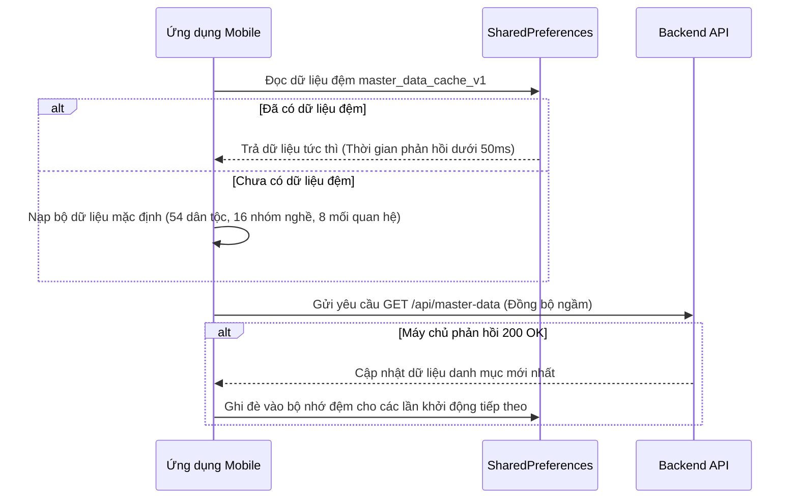
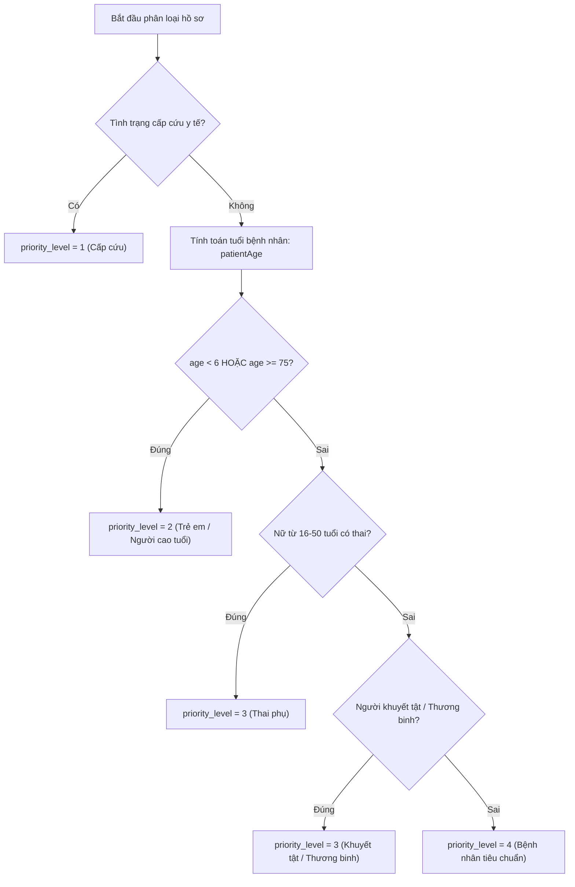
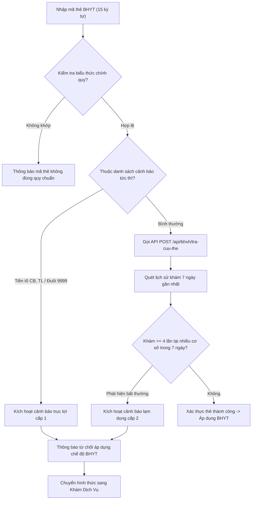

# TÀI LIỆU THIẾT KẾ KIẾN TRÚC VÀ ĐẶC TẢ NGHIỆP VỤ HỆ THỐNG PATIENT-MOBILE

| Thông tin đề tài | Nội dung chi tiết |
|---|---|
| **Đồ án / Khóa luận** | Hệ thống Quản lý Phòng khám Thông minh (Clinic Management System) |
| **Phân hệ ứng dụng** | Ứng dụng di động dành cho Bệnh nhân (`patient_mobile`) |
| **Nền tảng & Ngôn ngữ** | Flutter SDK (Dart) |
| **Kiến trúc phần mềm** | MVC / Controller - Service Pattern với GetX State Management |
| **Hệ thống Backend** | Laravel 11 RESTful API (PHP 8.3) |
| **Hệ cơ sở dữ liệu** | MySQL (`QuanLyKhamChuaBenh`) |
| **Thời gian cập nhật** | Tháng 11/2026 |

---

## MỤC LỤC

1. [TỔNG QUAN HỆ THỐNG (SYSTEM OVERVIEW)](#1-tổng-quan-hệ-thống)
2. [CÔNG NGHỆ VÀ THƯ VIỆN CỐT LÕI (TECH STACK)](#2-công-nghệ-và-thư-viện-cốt-lõi)
3. [CẤU TRÚC THƯ MỤC DỰ ÁN (PROJECT STRUCTURE)](#3-cấu-trúc-thư-mục-dự-án)
4. [CHI TIẾT LOGIC NGHIỆP VỤ VÀ THUẬT TOÁN CÁC PHÂN HỆ](#4-chi-tiết-logic-nghiệp-vụ-và-thuật-toán-các-phân-hệ)
   - [4.1. Phân hệ Xác thực và Quản lý Phiên Người dùng (Auth Module)](#41-phân-hệ-xác-thực-và-quản-lý-phiên-người-dùng)
   - [4.2. Phân hệ Quản lý Hồ sơ Bệnh nhân, Ràng buộc Y tế và Địa chính Đa cấp (Patient Profiles & Master Data)](#42-phân-hệ-quản-lý-hồ-sơ-bệnh-nhân-ràng-buộc-y-tế-và-địa-chính-đa-cấp)
   - [4.3. Phân hệ Đặt lịch Khám, Giỏ khám và Chống Tranh chấp Khung giờ (Booking Concurrency & Cart Engine)](#43-phân-hệ-đặt-lịch-khám-giỏ-khám-và-chống-tranh-chấp-khung-giờ)
   - [4.4. Phân hệ Phân tầng Ưu tiên Y tế (Smart Priority Algorithm)](#44-phân-hệ-phân-tầng-ưu-tiên-y-tế)
   - [4.5. Phân hệ Động cơ Tính phí BHYT và Miễn đồng Chi trả (Health Insurance Engine)](#45-phân-hệ-động-cơ-tính-phí-bhyt-và-miễn-đồng-chi-trả)
   - [4.6. Phân hệ Giám định BHYT và Kiểm soát Lạm dụng Thẻ (Fraud Detection Gateway)](#46-phân-hệ-giám-định-bhyt-và-kiểm-soát-lạm-dụng-thẻ)
   - [4.7. Phân hệ Thanh toán Viện phí Trực tuyến VNPay (Payment Gateway)](#47-phân-hệ-thanh-toán-viện-phí-trực-tuyến-vnpay)
   - [4.8. Phân hệ Tiếp nhận Tự động và Phiếu khám QR Điện tử (Digital E-Ticket Check-in)](#48-phân-hệ-tiếp-nhận-tự-động-và-phiếu-khám-qr-điện-tử)
   - [4.9. Phân hệ Điều phối Hàng đợi Thời gian thực và Cảnh báo Tự động (Live Queue Tracker & FCM)](#49-phân-hệ-điều-phối-hàng-đợi-thời-gian-thực-và-cảnh-báo-tự-động)
   - [4.10. Phân hệ Bệnh án Điện tử và Đơn thuốc Số (EMR & Prescriptions)](#410-phân-hệ-bệnh-án-điện-tử-và-đơn-thuốc-số)
   - [4.11. Module Hỗ trợ Giải thích Kết quả Cận lâm sàng qua Gemini API (Medical AI Explainer Streaming)](#411-module-hỗ-trợ-giải-thích-kết-quả-cận-lâm-sàng-qua-gemini-api)
5. [MA TRẬN KẾT NỐI API BACKEND (API INTEGRATION MATRIX)](#5-ma-trận-kết-nối-api-backend)
6. [AN TOÀN BẢO MẬT VÀ QUẢN LÝ DỮ LIỆU CỤC BỘ](#6-an-toàn-bảo-mật-và-quản-lý-dữ-liệu-cục-bộ)

---

## 1. TỔNG QUAN HỆ THỐNG

Ứng dụng `patient_mobile` là cổng thông tin và dịch vụ y tế trực tuyến dành cho bệnh nhân (Patient Portal) thuộc hệ sinh thái Quản lý Phòng khám Thông minh. Ứng dụng số hóa quy trình tiếp đón ngoại trú với các nhiệm vụ kỹ thuật trọng tâm:

1. **Đăng ký khám bệnh từ xa:** Cho phép bệnh nhân chủ động lựa chọn chuyên khoa, bác sĩ phụ trách, ngày khám và khung giờ còn trống theo thời gian thực.
2. **Phân luồng đối tượng dịch vụ:** Tách biệt rõ ràng quy trình đăng ký Khám Dịch Vụ và Khám Bảo hiểm Y tế (BHYT) ngay từ bước khởi tạo lịch hẹn.
3. **Tự động hóa định mức chi phí BHYT:** Triển khai thuật toán tính chi phí tuân thủ Thông tư 22/2023/TT-BYT và Thông tư 39/2024/TT-BYT; tự động áp dụng miễn đồng chi trả đối với tổng chi phí BHYT dưới ngưỡng 15% mức lương cơ sở.
4. **Kiểm soát lạm dụng thẻ bảo hiểm:** Thiết lập cổng kiểm tra lịch sử khám nhằm nhận diện các dấu hiệu gom thuốc hoặc đăng ký trùng lặp nhiều nơi trong thời gian ngắn.
5. **Thanh toán số bảo mật:** Tích hợp cổng thanh toán trực tuyến VNPay qua cơ chế tạo chữ ký số bảo mật HMAC-SHA512.
6. **Tiếp đón không chạm qua mã QR:** Cung cấp Phiếu tiếp nhận điện tử (E-Ticket) với mã QR động phục vụ check-in tự động tại quầy tiếp đón.
7. **Điều phối hàng đợi thông minh:** Cập nhật số thứ tự đang khám, tính toán thời gian chờ ước tính (ETA) và kích hoạt thông báo đẩy (FCM Push Notification) khi người bệnh chuẩn bị tới lượt.
8. **Bệnh án điện tử và đơn thuốc:** Lưu trữ và đồng bộ hóa lịch sử khám, chẩn đoán ICD, phiếu kết quả cận lâm sàng và hướng dẫn sử dụng thuốc.
9. **Hỗ trợ giải thích chỉ số y khoa:** Ứng dụng mô hình ngôn ngữ lớn (Google Gemini) để dịch thuật ngữ xét nghiệm sang giải thích dễ hiểu theo cơ chế truyền tải luồng thời gian thực (Streaming).

---

## 2. CÔNG NGHỆ VÀ THƯ VIỆN CỐT LÕI

| Nhóm công nghệ | Thư viện / Công cụ | Phiên bản | Mục đích triển khai |
|---|---|---|---|
| **Nền tảng chính** | Flutter SDK | `^3.11.3` | Khung ứng dụng đa nền tảng (Android / iOS) |
| **Quản trị trạng thái** | `get` (GetX) | `^4.7.3` | Quản lý trạng thái phản ứng (Reactive State `Obx`), điều hướng Route và Dependency Injection |
| **Giao tiếp mạng** | `http`, `dio` | `^1.6.0`, `^5.11.1` | Thực thi các yêu cầu RESTful API với Laravel Backend, quản lý Interceptor và Timeout |
| **Thông báo đẩy** | `firebase_messaging` | `^16.7.0` | Tiếp nhận thông báo đám mây (FCM) khi có thay đổi trạng thái phiên khám hoặc tiến trình hàng đợi |
| **Thông báo cục bộ** | `flutter_local_notifications` | `^22.3.1` | Hiển thị biểu ngữ thông báo nổi khi ứng dụng đang hoạt động ở Foreground |
| **Mã vạch & QR** | `qr_flutter` | `^4.1.0` | Tạo mã QR cho Phiếu tiếp nhận điện tử (E-Ticket) |
| **Mã hóa & Chữ ký số** | `crypto`, `url_launcher` | `^3.0.7`, `^6.3.3` | Tạo chuỗi băm HMAC-SHA512 bảo mật cho cổng VNPay và điều hướng thanh toán |
| **Hỗ trợ y khoa AI** | `google_generative_ai`, `dash_chat_2` | `^0.4.7`, `^0.0.21` | Tích hợp mô hình Gemini phân tích chỉ số cận lâm sàng, streaming câu trả lời và giao diện hội thoại |
| **Lưu trữ dữ liệu an toàn** | `flutter_secure_storage`, `shared_preferences` | `^11.2.0`, `^2.5.5` | Lưu trữ Token JWT an toàn trong Keystore/Keychain, bộ nhớ đệm hồ sơ bệnh nhân và Master Data |

---

## 3. CẤU TRÚC THƯ MỤC DỰ ÁN

```text
lib/
├── core/
│   ├── address/                               # Module đơn vị hành chính đa quốc gia
│   │   ├── controllers/
│   │   │   └── address_cascading_controller.dart # Quản lý trạng thái Cascading Dropdown 4 cấp
│   │   ├── data/
│   │   │   └── international_address_data.dart   # Dữ liệu tĩnh 63 tỉnh VN và bang quốc tế
│   │   ├── models/
│   │   │   └── administrative_unit.dart          # Mô hình dữ liệu địa chính
│   │   ├── repositories/
│   │   │   ├── address_repository.dart           # Repository tra cứu dữ liệu địa phương
│   │   │   └── vietnam_address_repository.dart   # Repository riêng cho 63 tỉnh/thành Việt Nam
│   │   └── widgets/
│   │       └── cascading_address_picker.dart     # Widget chọn Quốc gia -> Tỉnh -> Huyện -> Xã
│   ├── app_colors.dart                        # Bảng màu chuẩn giao diện y tế
│   ├── app_theme.dart                         # Định nghĩa ThemeData, Typography và InputDecoration
│   └── constants/
│       └── api_constants.dart                 # Cấu hình địa chỉ máy chủ Backend và Endpoint
├── firebase_options.dart                      # Cấu hình dịch vụ Firebase Cloud Messaging
├── main.dart                                  # Điểm khởi tạo ứng dụng, Services và Routing
├── screens/
│   ├── auth/                                  # Module xác thực người dùng
│   │   ├── login_screen.dart                  # Đăng nhập bằng số điện thoại và mật khẩu
│   │   ├── register_phone_screen.dart         # Đăng ký tài khoản và gửi mã xác thực
│   │   ├── set_password_screen.dart           # Thiết lập mật khẩu mới
│   │   └── verify_otp_screen.dart             # Xác minh mã OTP
│   ├── booking/                               # Module quy trình đặt lịch khám
│   │   ├── booking_screen.dart                # Khởi tạo quy trình (Phân luồng Dịch vụ / BHYT)
│   │   ├── controllers/
│   │   │   └── booking_controller.dart        # Controller quản lý giỏ khám, tính phí và giới hạn BHYT
│   │   ├── views/
│   │   │   ├── specialty_screen.dart          # Lựa chọn chuyên khoa và hiển thị giá niêm yết
│   │   │   ├── doctor_list_screen.dart        # Danh sách bác sĩ theo chuyên khoa
│   │   │   ├── date_selection_screen.dart     # Lựa chọn ngày khám
│   │   │   ├── time_slot_screen.dart          # Chọn khung giờ còn trống (Slot 30 phút)
│   │   │   ├── insurance_screen.dart          # Nhập và kiểm tra tính hợp lệ của thẻ BHYT
│   │   │   ├── select_profile_screen.dart     # Chọn hồ sơ bệnh nhân cho phiên khám
│   │   │   ├── summary_screen.dart            # Bảng tổng hợp chi phí và chọn phương thức thanh toán
│   │   │   ├── review_summary_screen.dart     # Màn hình xem lại thông tin lịch hẹn
│   │   │   ├── payment_pending_screen.dart    # Màn hình chờ kết quả thanh toán trực tuyến
│   │   │   ├── booking_success_screen.dart    # Xác nhận đặt lịch và cấp mã QR tiếp nhận
│   │   │   ├── e_ticket_screen.dart           # Phiếu tiếp nhận điện tử kèm bộ theo dõi hàng đợi
│   │   │   └── appointment_list_screen.dart   # Danh sách các lịch hẹn của tài khoản
│   │   └── widgets/
│   │       ├── advanced_doctor_card.dart      # Thẻ thông tin bác sĩ chi tiết
│   │       ├── confirmation_step.dart         # Bước xác nhận thông tin đặt khám
│   │       ├── doctor_card.dart               # Thẻ bác sĩ tiêu chuẩn
│   │       ├── doctor_selection_step.dart     # Bước lựa chọn bác sĩ
│   │       ├── step_indicator.dart            # Thanh chỉ dẫn tiến trình các bước đặt lịch
│   │       ├── time_selection_step.dart       # Bước lựa chọn thời gian
│   │       └── time_slot_grid.dart            # Lưới hiển thị các khung giờ trống
│   ├── chatbot/                               # Module hội thoại tư vấn sức khỏe
│   │   ├── chatbot_controller.dart            # Điều phối tin nhắn và gọi API Gemini
│   │   └── chatbot_screen.dart                # Giao diện trao đổi thông tin y tế
│   ├── emr/                                   # Module bệnh án điện tử và đơn thuốc
│   │   ├── emr_screen.dart                    # Màn hình tổng hợp hồ sơ sức khỏe
│   │   └── widgets/
│   │       ├── medical_ai_explainer_sheet.dart# BottomSheet hiển thị streaming giải thích xét nghiệm
│   │       ├── test_results_tab.dart          # Danh sách kết quả cận lâm sàng
│   │       ├── visit_detail_screen.dart       # Chi tiết lượt khám (Chẩn đoán, Đơn thuốc, Chỉ định)
│   │       ├── visit_history_tab.dart         # Lịch sử các lần khám theo trục thời gian
│   │       └── visit_timeline_item.dart       # Phần tử hiển thị mốc lịch sử khám
│   ├── home/                                  # Module trang chủ
│   │   ├── home_screen.dart                   # Bảng điều khiển chính của bệnh nhân
│   │   ├── notification_screen.dart           # Trung tâm thông báo hệ thống
│   │   ├── controllers/
│   │   │   ├── home_controller.dart           # Tải lịch hẹn gần nhất và thông tin người dùng
│   │   │   └── notification_controller.dart   # Quản lý danh sách và trạng thái đọc thông báo
│   │   └── widgets/
│   │       ├── custom_header.dart             # Header chào mừng và định danh tài khoản
│   │       ├── feature_grid.dart              # Lưới chức năng chính
│   │       ├── patient_id_card.dart           # Thẻ nhận diện bệnh nhân điện tử
│   │       └── upcoming_appointment_card.dart # Thẻ lịch hẹn sắp tới tích hợp hàng đợi rút gọn
│   ├── main/                                  # Điều hướng phân cấp ứng dụng
│   │   └── main_screen.dart                   # Bottom Navigation Bar liên kết các tab chính
│   ├── payment/                               # Quản lý giao dịch viện phí
│   │   ├── payment_screen.dart                # Danh sách hóa đơn và phiếu thanh toán
│   │   └── controllers/
│   │       └── payment_tab_controller.dart    # Phân loại trạng thái thanh toán (Đã thu / Chờ thu)
│   └── profile/                               # Module quản lý hồ sơ bệnh nhân
│       ├── change_password_screen.dart        # Đổi mật khẩu tài khoản
│       ├── create_profile_screen.dart         # Tạo mới hồ sơ bệnh nhân với các ràng buộc y tế
│       ├── personal_info_screen.dart          # Xem và cập nhật thông tin cá nhân
│       ├── profile_empty_screen.dart          # Trạng thái khi chưa tạo hồ sơ bệnh nhân
│       ├── search_profile_screen.dart         # Tra cứu hồ sơ bệnh nhân theo tiêu chí
│       ├── user_profile_screen.dart           # Quản lý tài khoản chính
│       ├── controllers/
│       │   └── patient_profile_controller.dart# Validator y tế, bóc tách CCCD 12 số và khóa reactive
│       └── widgets/
│           └── profile_type_bottom_sheet.dart # Chọn loại quan hệ hồ sơ (Kiểm soát duy nhất hồ sơ Bản thân)
├── services/
│   ├── auth_service.dart                      # Dịch vụ quản lý phiên JWT và trạng thái đăng nhập
│   ├── booking_api_service.dart               # Dịch vụ gọi API danh mục, lịch khám và hàng đợi
│   ├── emr_service.dart                       # Dịch vụ truy vấn bệnh án, đơn thuốc và kết quả xét nghiệm
│   ├── fcm_service.dart                       # Xử lý token FCM và điều hướng thông báo đẩy
│   ├── master_data_service.dart               # Tải và lưu trữ cục bộ Master Data (Cache-First)
│   ├── medical_ai_service.dart                # Dịch vụ phân tích cận lâm sàng qua Gemini Streaming
│   ├── patient_profile_service.dart           # Đồng bộ hóa danh sách hồ sơ bệnh nhân
│   └── vnpay_service.dart                     # Xây dựng tham số thanh toán VNPay và tạo URL ký số
└── widgets/
    └── live_queue_tracker_widget.dart         # Widget theo dõi tiến trình hàng đợi khám trực tiếp
```

---

## 4. CHI TIẾT LOGIC NGHIỆP VỤ VÀ THUẬT TOÁN CÁC PHÂN HỆ

### 4.1. Phân hệ Xác thực và Quản lý Phiên Người dùng

#### A. Ràng buộc Định dạng Số điện thoại Di động Việt Nam (`VietnamesePhoneRule`)
Hệ thống kiểm soát chặt chẽ định dạng số điện thoại ngay từ khâu tiếp nhận tài khoản (Đăng ký, gửi mã xác thực OTP và Đặt mật khẩu), không chỉ giới hạn ở bước tạo hồ sơ:

- **Biểu thức chính quy kiểm tra:** `^(0|\+84)(3|5|7|8|9)[0-9]{8}$`
- **Quy chuẩn dải đầu số:** Bắt buộc gồm 10 chữ số (đối với định dạng nội địa bắt đầu bằng `0`) hoặc 11 ký tự (đối với định dạng quốc tế `+84`), kết hợp với các đầu mạng viễn thông hợp lệ sau quy hoạch: `03x`, `05x`, `07x`, `08x`, `09x`.
- **Nhận diện đầu số cũ:** Khi người dùng nhập số có tiền tố `01` hoặc `+841` (đầu số 11 chữ số trước năm 2018), hệ thống hiển thị thông báo lỗi chỉ dẫn: *"Đầu số 01 đã ngừng hoạt động từ năm 2018. Vui lòng nhập đầu số 10 số (03, 05, 07, 08, 09)."*
- **Triển khai đồng bộ Client & Server:**
  - *Ứng dụng Mobile (`RegisterPhoneScreen.dart`):* Hàm `_sendOtp()` gọi trực tiếp `MedicalValidators.validatePhone()` để chặn các số sai định dạng trước khi kích hoạt dịch vụ gửi SMS.
  - *Backend API:* Các Form Request của phân hệ Auth (`SendOtpRequest`, `SetPasswordRequest`) áp dụng trực tiếp rule kiểm tra:
    ```php
    'phone_number' => ['required', 'string', new VietnamesePhoneRule(), 'unique:users,phone_number']
    ```

#### B. Thuật toán chuẩn hóa định danh Số điện thoại
Số điện thoại tại Việt Nam có thể tồn tại ở định dạng số trong nước (`0xxxxxxxxx`) hoặc định dạng quốc tế (`+84xxxxxxxxx`). Để đảm bảo tính nhất quán khi định danh người dùng:

```text
Thuật toán Chuẩn hóa Số điện thoại (Input: Chuỗi P):
1. Nếu P bắt đầu bằng "+84":
     CleanPhone = "0" + P.substring(3)
     IntlPhone  = P
2. Nếu P bắt đầu bằng "0":
     CleanPhone = P
     IntlPhone  = "+84" + P.substring(1)
3. Backend thực hiện truy vấn đối soát:
     WHERE phone_number IN (P, CleanPhone, IntlPhone)
```

#### C. Cơ chế xác thực JWT và đồng bộ thiết bị FCM
1. **Lưu trữ phiên an toàn:** Mã thông báo truy cập (JWT Bearer Token) được lưu trong vùng nhớ mã hóa của hệ điều hành qua `flutter_secure_storage` (Android Keystore / iOS Keychain).
2. **HTTP Interceptor:** Mọi yêu cầu gửi lên máy chủ đều được tự động bổ sung Header: `Authorization: Bearer <Token>`.
3. **Đăng ký nhận thông báo:** Sau khi đăng nhập thành công, client lấy chuỗi `fcm_token` từ Firebase SDK và gửi lên máy chủ qua endpoint `POST /api/user/fcm-token` để liên kết thiết bị với tài khoản người bệnh.

#### D. Chính sách Ràng buộc Độ phức tạp Mật khẩu (Password Complexity Policy)
Để đảm bảo an toàn thông tin y tế của người bệnh và ngăn ngừa các cuộc tấn công dò quét mật khẩu (Brute-force / Dictionary Attacks), hệ thống thiết lập chính sách mật khẩu nghiêm ngặt, bắt buộc áp dụng đồng bộ ở cả hai phía Client và Server:

- **Các tiêu chuẩn ràng buộc bắt buộc:**
  1. Độ dài tối thiểu: Phải có ít nhất **08 ký tự** (`min:8`).
  2. Bắt buộc có chữ in thường: Phải chứa ít nhất **01 chữ cái thường** (`regex:/[a-z]/`).
  3. Bắt buộc có chữ in hoa: Phải chứa ít nhất **01 chữ cái in hoa** (`regex:/[A-Z]/`).
  4. Bắt buộc có ký tự đặc biệt: Phải chứa ít nhất **01 ký tự đặc biệt** trong tập hợp `[!@#$%^&*(),.?":{}|<>]` (`regex:/[@$!%*#?&]/`).
- **Thực thi đồng bộ 2 lớp (Two-layer Enforcement):**
  - *Client-side (`set_password_screen.dart`, `change_password_screen.dart`):* Hàm `_validatePassword()` thực hiện kiểm tra động theo thời gian thực (Real-time Validation). Khi người dùng nhập liệu hoặc nhấn nút gửi, lỗi vi phạm cụ thể sẽ hiển thị ngay dưới trường nhập.
  - *Server-side Form Request (`SetPasswordRequest.php` và `AuthController::changePassword`):*
    ```php
    'password' => [
        'required',
        'string',
        'min:8',
        'regex:/[a-z]/',
        'regex:/[A-Z]/',
        'regex:/[@$!%*#?&]/',
    ]
    ```
    Mọi yêu cầu có mật khẩu không đạt chuẩn (ví dụ mật khẩu quá ngắn hoặc chỉ gồm số đơn thuần như `123456`) đều bị Backend từ chối ngay lập tức với mã lỗi HTTP 422 Unprocessable Entity.

#### E. Cơ chế Đổi Mật khẩu Người dùng (Change Password Architecture)
- **Màn hình giao diện:** `ChangePasswordScreen` (`lib/screens/profile/change_password_screen.dart`).
- **Endpoint tiếp nhận:** `POST /api/change-password`
- **Quy trình xử lý đối soát 4 bước tại Backend:**
  1. *Định danh phiên:* Lấy số điện thoại người dùng từ phiên đăng nhập an toàn (`AuthService::getUserPhone()`), chuẩn hóa định dạng số điện thoại (`0xxx`, `+84xxx`, `84xxx`).
  2. *Đối soát mật khẩu hiện tại:* Sử dụng `Hash::check($request->current_password, $user->password)` để kiểm tra tính chính xác của mật khẩu cũ. Nếu không trùng khớp, hệ thống từ chối yêu cầu và phản hồi HTTP 400: *"Mật khẩu hiện tại không chính xác"*.
  3. *Kiểm tra ràng buộc mật khẩu mới:* Xác thực mật khẩu mới theo chính sách phức tạp ở Mục D, đồng thời kiểm tra sự trùng khớp giữa `new_password` và `confirm_password`.
  4. *Mã hóa Bcrypt và Cập nhật đồng bộ:* Mã hóa mật khẩu mới bằng giải thuật Bcrypt (`Hash::make($request->new_password)`) với hệ số vòng băm `BCRYPT_ROUNDS=12`. Cập nhật đồng bộ trên toàn bộ các bản ghi đại diện của số điện thoại đó trong bảng `users` nhằm đảm bảo tính toàn vẹn dữ liệu.

#### F. Cơ chế Quên và Thiết lập Mật khẩu qua OTP Firebase (Password Recovery)
1. **Xác minh số điện thoại:** Người dùng nhập số điện thoại -> Hệ thống gọi Firebase Phone Auth gửi mã OTP 6 số về máy (hoặc xác thực OTP tĩnh đối với số thử nghiệm).
2. **Kích hoạt quyền đặt mật khẩu:** Sau khi Firebase SDK xác thực mã OTP thành công, ứng dụng điều hướng người dùng tới màn hình `SetPasswordScreen`.
3. **Cập nhật mật khẩu:** Người dùng nhập mật khẩu mới thỏa mãn chính sách bảo mật -> Gửi tới endpoint `POST /api/set-password` -> Backend cập nhật mật khẩu đã băm vào cơ sở dữ liệu và tự động cấp phát JWT Token mới để tiếp tục phiên làm việc mà không cần đăng nhập lại.

---

### 4.2. Phân hệ Quản lý Hồ sơ Bệnh nhân, Ràng buộc Y tế và Địa chính Đa cấp

#### A. Mô hình Quản lý 1 - N (Tài khoản - Đa Hồ sơ)
Một tài khoản người dùng (`TaiKhoan` gắn với số điện thoại) được phép tạo và quản lý nhiều hồ sơ bệnh nhân (`HoSoBenhAn`) đại diện cho bản thân hoặc các thành viên trong gia đình (con cái, cha mẹ, vợ/chồng).

#### B. Ràng buộc Tính duy nhất của Hồ sơ "Bản thân"
- **Quy chuẩn nghiệp vụ:** Mỗi tài khoản số điện thoại chỉ được phép tồn tại duy nhất một hồ sơ bệnh án có mối quan hệ là "Bản thân" (`quan_he == 'Bản thân'`).
- **Xử lý tại Client:** Trong `ProfileTypeBottomSheet` và `CreateProfileScreen`, ứng dụng kiểm tra danh mục hồ sơ hiện có; nếu đã tồn tại hồ sơ Bản thân, tùy chọn này sẽ tự động bị ẩn hoặc vô hiệu hóa, hướng dẫn người dùng chọn các mối quan hệ người thân khác.
- **Kiểm soát tại Backend:** `StoreBenhNhanRequest` và `PatientProfileRequest` áp dụng hàm kiểm tra ràng buộc trước khi ghi dữ liệu:

```php
private function checkUniqueSelfProfile(string $soDienThoai, string $quanHe): void
{
    if (trim($quanHe) !== 'Bản thân') return;

    $phone0 = str_starts_with($soDienThoai, '+84') ? '0' . substr($soDienThoai, 3) : $soDienThoai;
    $phone84 = str_starts_with($soDienThoai, '0') ? '+84' . substr($soDienThoai, 1) : $soDienThoai;
    $currentId = $this->route('id');

    $exists = HoSoBenhAn::whereIn('so_dien_thoai', [$soDienThoai, $phone0, $phone84])
        ->where('quan_he', 'Bản thân')
        ->when($currentId, fn($q, $id) => $q->where('ma_ho_so', '!=', $id))
        ->exists();

    if ($exists) {
        throw new HttpResponseException(response()->json([
            'status' => 'error',
            'message' => "Số điện thoại này đã có một hồ sơ Bản thân. Mỗi tài khoản chỉ được phép sở hữu duy nhất một hồ sơ Bản thân."
        ], 422));
    }
}
```

#### C. Quy chuẩn CCCD 12 số, Thuật toán Bóc tách và Cơ chế Khóa Reactive
- **Cấu trúc 12 chữ số theo quy chuẩn Bộ Công an ($C_1C_2...C_{12}$):**
  - **Mã tỉnh/thành phố khai sinh ($C_1C_2C_3$):** 3 chữ số đầu, dải giá trị từ $001$ đến $096$.
  - **Mã thế kỷ và giới tính ($C_4$):**
    - Thế kỷ 20 (1900–1999): Nam = 0, Nữ = 1
    - Thế kỷ 21 (2000–2099): Nam = 2, Nữ = 3
    - Thế kỷ 22 (2100–2199): Nam = 4, Nữ = 5
    - Công thức suy luận:
      $$\text{Gender} = \begin{cases} 1 \text{ (Nam)} & \text{khi } C_4 \pmod 2 = 0 \\ 0 \text{ (Nữ)} & \text{khi } C_4 \pmod 2 \ne 0 \end{cases}$$
      $$\text{CenturyBase} = 1900 + (\lfloor C_4 / 2 \rfloor \times 100)$$
  - **Hai chữ số cuối của năm sinh ($C_5C_6$):**
    $$\text{BirthYear} = \text{CenturyBase} + \text{int}(C_5C_6)$$
  - **Mã định danh ngẫu nhiên ($C_7..C_{12}$):** Dãy 6 chữ số định danh cá nhân duy nhất.

- **Cơ chế Khóa Phản ứng (Reactive Lock Engine):**
  - Khi người dùng nhập đủ 12 chữ số CCCD hợp lệ, `PatientProfileController.parseCccdInfo()` tự động trích xuất Giới tính và Năm sinh, cập nhật trực tiếp vào State phản ứng và bật cờ `isCccdLocked = true`.
  - **Áp dụng đồng bộ cho cả luồng Tạo mới và Chỉnh sửa hồ sơ (`isEditing`):** Khi mở form chỉnh sửa một hồ sơ đã lưu số CCCD, hàm `initFromExisting()` tự động bóc tách CCCD và kích hoạt khóa ngay lập tức. Người dùng **không thể tùy ý thay đổi Giới tính và Năm sinh** của hồ sơ bệnh nhân đã định danh:
    1. **Giới tính:** Bị vô hiệu hóa hoàn toàn (Disable Radio selection), không cho phép đổi giới tính.
    2. **Năm sinh:** Hộp thoại chọn Ngày sinh (DatePicker) chỉ cho phép điều chỉnh ngày và tháng; giá trị Năm sinh bị cưỡng chế khóa cứng theo năm trích xuất từ CCCD (`DateTime(birthYear.value!, pickedDate.month, pickedDate.day)`).
    3. **Nút Mở khóa có kiểm soát (`unlockCccd`):** Giao diện cung cấp nút icon ổ khóa mở. Để thay đổi năm sinh/giới tính, người dùng bắt buộc phải nhấn mở khóa để xóa trắng CCCD và nhập lại từ đầu, ngăn ngừa việc sửa dữ liệu gây mâu thuẫn nội tại.
  - Phía Backend (`StoreBenhNhanRequest`), hệ thống kiểm tra chéo: nếu phát hiện $(\text{ActualBirthYear} \ne \text{ExpectedBirthYear}) \lor (\text{ActualGender} \ne \text{ExpectedGender})$, giao dịch bị từ chối với mã phản hồi `HTTP 422`.

#### D. Quy định Người giám hộ cho Bệnh nhi dưới 14 tuổi
- **Thuật toán tính tuổi chính xác:**
  $$\text{age} = \text{now.year} - \text{dob.year} - (\text{now.month} < \text{dob.month} \lor (\text{now.month} = \text{dob.month} \land \text{now.day} < \text{dob.day}) \ ? \ 1 : 0)$$
  $$\text{isUnder14} = (\text{age} < 14)$$
- **Quy tắc kiểm tra hợp lệ dữ liệu:**
  - **Trường hợp bệnh nhân dưới 14 tuổi ($\text{isUnder14} = \text{true}$):**
    - Trường `cccd`: Chuyển sang trạng thái tùy chọn (`nullable`).
    - Trường `nguoi_lien_he_khan_cap`: Bắt buộc cung cấp số điện thoại hợp lệ của cha mẹ hoặc người giám hộ hợp pháp.
  - **Trường hợp bệnh nhân từ 14 tuổi trở lên ($\text{isUnder14} = \text{false}$):**
    - Trường `cccd`: Bắt buộc nhập đầy đủ 12 chữ số căn cước công dân.
    - Trường `nguoi_lien_he_khan_cap`: Tùy chọn.

#### E. Bộ kiểm tra Thẻ BHYT 15 ký tự và Kiểm tra chéo Độ tuổi (QĐ 1666/QĐ-BHXH)
- **Quy chuẩn định dạng 15 ký tự:**
  - **Ký tự 1-2:** Mã nhóm đối tượng tham gia bảo hiểm. Phải thuộc danh mục 29 mã chuẩn hóa: `DN, HX, CH, NN, TK, HC, XK, HT, TB, NO, QN, CA, CY, CB, KC, TE, BT, HN, DT, DK, XD, TS, TC, CN, HS, SV, GB, GD, PV`.
  - **Ký tự 3:** Mức hưởng quyền lợi BHYT (từ `1` đến `5`).
  - **Ký tự 4-5:** Mã tỉnh/thành phố cấp thẻ (từ `01` đến `96`).
  - **10 ký tự cuối:** Mã số định danh bảo hiểm xã hội cá nhân (`^[0-9]{10}$`).
- **Quy tắc đối soát chéo Mã đối tượng BHYT với độ tuổi:**

| Mã thẻ | Nhóm đối tượng quy định | Điều kiện độ tuổi | Xử lý khi không đáp ứng |
|:---:|---|---|---|
| `TE` | Trẻ em dưới 6 tuổi | $\text{Age} < 6$ | Từ chối nếu $\text{Age} \ge 6$: Mã thẻ TE chỉ dành cho trẻ em dưới 6 tuổi |
| `HS` | Học sinh phổ thông | $6 \le \text{Age} \le 18$ | Từ chối nếu tuổi nằm ngoài khoảng $6 - 18$ |
| `SV` | Sinh viên Đại học / Cao đẳng | $18 \le \text{Age} \le 30$ | Từ chối nếu tuổi nằm ngoài khoảng $18 - 30$ |
| `HT` | Người hưởng lương hưu (Hưu trí) | $\text{Age} \ge 50$ | Từ chối nếu $\text{Age} < 50$ |

- **Kiểm soát xuyên suốt vòng đời hồ sơ:** Quy chuẩn mã thẻ BHYT và ma trận kiểm tra chéo độ tuổi được áp dụng bắt buộc cho cả thao tác tạo mới và chỉnh sửa hồ sơ (`isEditing`). Mọi hành vi cập nhật hoặc sửa đổi mã thẻ BHYT không tương thích với nhóm tuổi thực tế của người bệnh (ví dụ: người lớn sửa sang mã `TE` trẻ em hoặc `HS` học sinh) đều bị chặn ngay tại Client và từ chối với lỗi `HTTP 422` từ Backend (`StoreBenhNhanRequest::crossCheckBhytVsAge`).

#### F. Kế thừa Ràng buộc Số điện thoại cho Hồ sơ Bệnh nhân và Người giám hộ
Tương tự như phân hệ Xác thực, số điện thoại liên hệ của bệnh nhân (`so_dien_thoai`) và số điện thoại người giám hộ (`nguoi_lien_he_khan_cap`) trong hồ sơ bệnh án đều kế thừa bắt buộc quy chuẩn `VietnamesePhoneRule`:
- Bắt buộc đúng cấu trúc 10 số di động Việt Nam (`03x`, `05x`, `07x`, `08x`, `09x`).
- Đảm bảo tính toàn vẹn và đồng bộ dữ liệu giữa bảng tài khoản (`users.phone_number`) và bảng hồ sơ (`ho_so_benh_an.so_dien_thoai`).

#### G. Thuật toán Master Data Cache-First
Để duy trì khả năng hoạt động ngay cả khi kết nối mạng không ổn định, `MasterDataService` áp dụng cơ chế lưu trữ đệm ưu tiên (Cache-First):



#### H. Thuật toán Lựa chọn Địa chính Đa cấp 4 bước
Tiến trình lựa chọn phân cấp địa phương:

$$\text{Quốc Gia} \longrightarrow \text{Tỉnh / Thành Phố / Bang} \longrightarrow \text{Quận / Huyện} \longrightarrow \text{Phường / Xã}$$

- Khi chọn **Việt Nam**: Tải danh mục đầy đủ 63 tỉnh, thành phố. Lọc tiếp danh mục Quận/Huyện/Thị xã và Phường/Xã tương ứng.
- Khi chọn quốc gia khác: Lọc theo danh mục tỉnh/bang quốc tế tương ứng đã chuẩn hóa.
- Định dạng địa chỉ thường trú hoàn chỉnh:
  $$\text{Địa chỉ} = \text{Số nhà, Tên đường} + \text{, } + \text{Phường/Xã} + \text{, } + \text{Quận/Huyện} + \text{, } + \text{Tỉnh/Thành} + \text{, } + \text{Quốc gia}$$

---

### 4.3. Phân hệ Đặt lịch Khám, Giỏ khám và Chống Tranh chấp Khung giờ

#### A. Thuật toán Phân bổ Khung giờ và Lọc giờ còn trống
- Giờ làm việc tiêu chuẩn: Ca sáng $07:30 - 11:30$, Ca chiều $13:30 - 17:00$. Mỗi phiên khám tiêu chuẩn kéo dài **30 phút**.
- Backend kiểm tra số lượt khám đã được giữ chỗ hoặc đặt thành công:

```text
Thuật toán: Lấy danh sách giờ trống (Mã bác sĩ B, Ngày khám D)
1. Tự động giải phóng các lượt đặt ở trạng thái 'cho_thanh_toan' quá thời hạn 15 phút:
   UPDATE luot_kham SET trang_thai = 'huy' 
   WHERE trang_thai = 'cho_thanh_toan' AND created_at <= (NOW() - 15 phút)

2. Khởi tạo tập hợp khung giờ làm việc: K = [07:30, 08:00, ..., 16:30]
3. Truy vấn số lượng lịch hẹn hiện hữu:
   BookedCounts = SELECT gio_bat_dau, COUNT(*) FROM luot_kham 
                  WHERE ma_bac_si = B AND DATE(thoi_gian_den_kham) = D AND trang_thai != 'huy' 
                  GROUP BY gio_bat_dau

4. Khởi tạo danh sách kết quả GioTrong = []
5. Duyệt từng khung giờ s trong K:
     Nếu (BookedCounts[s] < 1):
         GioTrong.append(s)
6. Trả về GioTrong
```

#### B. Thuật toán Khóa dòng tránh xung đột ghi đồng thời (Concurrency Control)
Khi có nhiều bệnh nhân cùng tiến hành thanh toán và xác nhận một khung giờ của cùng một bác sĩ:

```php
DB::transaction(function () use ($request) {
    // 1. Hủy các lượt giữ chỗ chưa hoàn tất trước đó của chính hồ sơ này tại cùng khung giờ
    LuotKham::where('ma_ho_so', $request->ma_ho_so)
        ->where('ma_bac_si', $request->ma_bac_si)
        ->where('thoi_gian_den_kham', $request->thoi_gian_den_kham)
        ->where('trang_thai', 'cho_thanh_toan')
        ->update(['trang_thai' => 'huy']);

    // 2. Thiết lập khóa độc quyền (Exclusive Lock) trên khung giờ yêu cầu
    $soNguoiDaDat = LuotKham::where('ma_bac_si', $request->ma_bac_si)
        ->where('thoi_gian_den_kham', $request->thoi_gian_den_kham)
        ->where('trang_thai', '!=', 'huy')
        ->lockForUpdate()
        ->count();

    if ($soNguoiDaDat >= 1) {
        throw new Exception('Khung giờ được chọn của bác sĩ đã có bệnh nhân đăng ký.');
    }

    // 3. Khởi tạo bản ghi lượt khám mới
    $luotKhamMoi = LuotKham::create([...]);
});
```

#### C. Cơ chế Giỏ khám Đa chuyên khoa và Kiểm soát Lỗi tích lũy Draft
- **Mục tiêu kỹ thuật:** Trong luồng đăng ký lịch khám đơn lẻ, khi người bệnh quay lại màn hình trước để thay đổi ngày khám hoặc chọn bác sĩ khác, hệ thống phải thực hiện thay thế bản nháp thay vì bổ sung vào danh sách giỏ hàng, tránh phát sinh lỗi vượt trần số lượt BHYT trong ngày.
- **Giải pháp triển khai:**
  1. Sử dụng biến cờ phản ứng `isAddingNewSpecialty = false.obs`. Cờ này chỉ chuyển sang giá trị `true` khi người bệnh chủ động chọn chức năng "Thêm chuyên khoa".
  2. Khi người bệnh thao tác trong luồng đơn lẻ (`!isAddingNewSpecialty && bookedItems.length <= 1`), hệ thống thực hiện làm mới bản nháp:
     ```dart
     if (existingIndex >= 0) {
       bookedItems[existingIndex] = newItem;
     } else if (!isAddingNewSpecialty.value && bookedItems.length <= 1) {
       bookedItems.clear();
       bookedItems.add(newItem);
     } else {
       bookedItems.add(newItem);
     }
     ```
  3. **Kiểm tra giới hạn BHYT theo ngày khám thực tế:** Nếu người dùng chưa chọn ngày (`selectedDate.value == null`), hệ thống không chặn sớm quyền chọn hình thức khám BHYT (`canSelectBhytForCurrentItem = true`). Việc kiểm tra giới hạn 2 lượt chỉ được thực thi khi đã xác định ngày cụ thể (`isBhytLimitReachedForDate(targetDate)`).

#### D. Thuật toán Xóa phiên làm việc (Anti Data Leakage)
Hàm `_resetBookingDraft()` tự động dọn sạch danh sách giỏ khám (`bookedItems.clear()`), biến cờ `isAddingNewSpecialty`, ngày, giờ, bác sĩ, chuyên khoa, hình thức đăng ký (`bookingType`) và phương thức thanh toán ngay khi hoàn thành đặt lịch hoặc khi người dùng thoát khỏi luồng đặt, ngăn ngừa hiện tượng rò rỉ trạng thái giữa các phiên làm việc khác nhau.

---

### 4.4. Phân hệ Phân tầng Ưu tiên Y tế

Hệ thống triển khai mô hình phân tầng ưu tiên 4 cấp độ nhằm đảm bảo tính công bằng và nguyên tắc cấp cứu trong khám chữa bệnh:



#### Ma trận đặc tả 4 cấp độ ưu tiên

| Cấp độ (`priority_level`) | Đối tượng áp dụng | Phương thức xác định | Quy tắc điều phối hệ thống |
|:---:|---|---|---|
| **Mức 1** | Cấp cứu y tế | Bác sĩ tiếp nhận chỉ định trực tiếp | Ưu tiên tuyệt đối, điều phối vào phòng khám ngay lập tức |
| **Mức 2** | Trẻ em (< 6 tuổi) và Người cao tuổi ($\ge$ 75 tuổi) | Tự động tính toán từ ngày sinh đối chiếu với ngày hiện tại | Tự động gán nhãn ưu tiên đối tượng theo độ tuổi, hiển thị huy hiệu nhận diện |
| **Mức 3** | Phụ nữ mang thai, Người khuyết tật, Thương bệnh binh | Bệnh nhân khai báo qua biểu mẫu thông tin (chỉ mở cho đối tượng nữ 16–50 tuổi) | Gán nhãn ưu tiên nhóm đặc biệt, xếp thứ tự trước bệnh nhân tiêu chuẩn |
| **Mức 4** | Bệnh nhân tiêu chuẩn | Mặc định đối với các trường hợp còn lại | Sắp xếp theo thứ tự đăng ký thông thường |

---

### 4.5. Phân hệ Động cơ Tính phí BHYT và Miễn đồng Chi trả

Động cơ tính toán tài chính y tế được thiết kế tuân thủ Thông tư 22/2023/TT-BYT, Thông tư 39/2024/TT-BYT và Luật Bảo hiểm Y tế Việt Nam.

#### A. Các tham số định mức tài chính
- `GIA_KHAM_NHA_NUOC = 42.100đ`: Định mức giá khám bệnh áp dụng thanh toán bảo hiểm y tế.
- `MAX_BHYT_PER_DATE = 2`: Số lượng chuyên khoa tối đa được áp dụng BHYT trên cùng một ngày khám tại một cơ sở y tế.
- `NGUONG_HOA_DON_NHO = 379.500đ`: Ngưỡng chi phí tương đương 15% mức lương cơ sở; theo quy định, các chi phí khám chữa bệnh ngoại trú dưới ngưỡng này được quỹ BHYT chi trả 100% trong phạm vi quyền lợi.

#### B. Thuật toán Phân tách Chi phí từng chuyên khoa (`itemCostBreakdown`)

```text
Thuật toán: itemCostBreakdown(items)
Khởi tạo:
- Result = []
- Map<DateString, Int> bhytSlotByDate = {}

Duyệt từng phần tử item trong items:
    Nếu (item.isBhyt == false):
        // Luồng Khám Dịch Vụ: Giữ nguyên 100% giá niêm yết của chuyên khoa
        basePrice = item.specialty.gia_kham
        Cost = totalPrice = basePrice
        PatientPayable = Cost
        Result.append({isBhyt: false, cost: Cost, patientPayable: PatientPayable})
    
    Ngược lại (Luồng Khám BHYT: Áp dụng giá nhà nước 42.100đ):
        dateKey = FormatDate(item.date)
        currentSlot = bhytSlotByDate[dateKey] + 1
        bhytSlotByDate[dateKey] = currentSlot
        
        Nếu (currentSlot == 1):
            ApprovedCost = 42100          // Lượt thứ 1 trong ngày: Quỹ duyệt 100% định mức
        Nếu (currentSlot == 2):
            ApprovedCost = round(42100 * 0.30) // Lượt thứ 2 trong ngày: Quỹ duyệt 30% = 12.630đ
        Nếu (currentSlot >= 3):
            ApprovedCost = 0              // Vượt định mức số lượt BHYT trong ngày -> Chặn
        
        Result.append({isBhyt: true, cost: ApprovedCost, patientPayable: 0})

// Xét miễn đồng chi trả đối với tổng chi phí BHYT nhỏ hơn 15% lương cơ sở
bhytSubtotal = SUM(item.cost đối với item có isBhyt == true)
isSmallInvoice = (bhytSubtotal < 379500)

Duyệt từng phần tử item trong Result có isBhyt == true:
    Nếu (isSmallInvoice == true):
        item.patientPayable = 0           // Miễn đồng chi trả
    Ngược lại:
        item.patientPayable = round(item.cost * (1 - cardBenefitRate))

Trả về Result
```

#### C. Thuật toán xác định mức hưởng BHYT (`cardBenefitRate`)
Căn cứ vào **ký tự thứ 3 của mã thẻ BHYT**:

$$R = \begin{cases} 
1.00 \text{ (100\%)} & \text{khi ký tự thứ 3 } \in \{'1', '2', '5'\} \\
0.95 \text{ (95\%)} & \text{khi ký tự thứ 3 } = '3' \\
0.80 \text{ (80\%)} & \text{khi ký tự thứ 3 } = '4' \\
0.80 \text{ (80\%)} & \text{mặc định}
\end{cases}$$

#### D. Công thức tài chính tổng kết đơn đặt khám
- **Tổng chi phí tiền công khám được quỹ BHYT chấp thuận:**
  $$\text{bhytCostBeforeInsurance} = \sum_{i \in \text{BHYT}} \text{ApprovedCost}_i$$
- **Số tiền người bệnh thực tế phải thanh toán:**
  $$\text{TotalBookingCost} = \sum \text{item.patientPayable}$$
  - Đối với Khám Dịch Vụ: $\text{TotalBookingCost} = \sum \text{gia\_kham}$.
  - Đối với Khám BHYT: Do tổng định mức tối đa 2 lượt ($42.100\text{đ} + 12.630\text{đ} = 54.730\text{đ}$) luôn nhỏ hơn ngưỡng $379.500\text{đ}$, chi phí thực tế người bệnh chi trả bằng **$0\text{đ}$**.
- **Cơ chế xác nhận tự động khi số tiền bằng 0đ:**
  $$\text{Nếu } \text{TotalBookingCost} = 0 \implies \text{trang\_thai} = \text{'da\_thanh\_toan'}$$
  Lịch hẹn được chuyển thẳng sang trạng thái đã thanh toán, hệ thống cấp số thứ tự và mở khóa mã QR tiếp nhận mà không cần chuyển tiếp sang cổng thanh toán trực tuyến.

---

### 4.6. Phân hệ Giám định BHYT và Kiểm soát Lạm dụng Thẻ

Hệ thống thiết lập quy trình kiểm tra nhiều lớp nhằm hạn chế tình trạng sử dụng thẻ sai mục đích hoặc đăng ký khám trùng lặp:



---

### 4.7. Phân hệ Thanh toán Viện phí Trực tuyến VNPay

#### A. Thuật toán tạo yêu cầu thanh toán và ký số HMAC-SHA512

```text
Thuật toán: createVNPayPaymentUrl(Mã lượt khám ID, Số tiền Amount)
1. vnp_Amount = Amount * 100
2. vnp_TxnRef = "LK_" + ID + "_" + Timestamp
3. Thiết lập tập hợp tham số đầu vào inputData:
     vnp_Version: "2.1.0",
     vnp_Command: "pay",
     vnp_TmnCode: VNPAY_TMN_CODE,
     vnp_Amount: vnp_Amount,
     vnp_CurrCode: "VND",
     vnp_TxnRef: vnp_TxnRef,
     vnp_OrderInfo: "Thanh toan phi kham luot #" + ID,
     vnp_ReturnUrl: VNPAY_RETURN_URL,
     vnp_IpAddr: Client_IP,
     vnp_CreateDate: Thời gian hiện tại định dạng "YmdHis",
     vnp_ExpireDate: Thời gian hết hạn sau 15 phút
4. Sắp xếp các khóa của inputData theo thứ tự bảng chữ cái (ksort).
5. Xây dựng chuỗi tham số hashData dạng: "key1=val1&key2=val2&..."
6. Tạo mã xác thực chữ ký:
     vnp_SecureHash = HMAC_SHA512(hashData, VNPAY_HASH_SECRET)
7. Trả về Payment_URL = Base_URL + "?" + Query + "&vnp_SecureHash=" + vnp_SecureHash
```

#### B. Thuật toán đối soát Callback Webhook (Return URL)
1. Tách chuỗi chữ ký `vnp_SecureHash` từ phản hồi của cổng thanh toán.
2. Tái tạo chữ ký băm từ toàn bộ các tham số bắt đầu bằng tiền tố `vnp_` còn lại.
3. Đối chiếu chữ ký bảo mật: Nếu trùng khớp và mã phản hồi `vnp_ResponseCode == '00'`:
   - Trích xuất danh sách mã lượt khám từ `vnp_TxnRef`.
   - Cập nhật đồng loạt trạng thái `da_thanh_toan` cho các bản ghi.
   - Gửi thông báo đẩy qua FCM đến thiết bị của người bệnh để kích hoạt hiển thị mã QR tiếp nhận.

---

### 4.8. Phân hệ Tiếp nhận Tự động và Phiếu khám QR Điện tử

- **Cấu trúc dữ liệu mã QR:** `http://<SERVER_IP>:8080/api/luot-kham/<ma_luot_kham>/tiep-nhan`
- **Tiến trình tiếp nhận tại cơ sở y tế:**
  1. Người bệnh xuất trình mã QR trên điện thoại trước máy đọc mã vạch tại quầy tiếp đón.
  2. Máy đọc kích hoạt endpoint `PUT /api/luot-kham/{id}/tiep-nhan`, Backend chuyển trạng thái lượt khám thành `cho_kham`.
  3. Màn hình phiếu khám trên ứng dụng di động duy trì chu kỳ Polling 3 giây (`checkStatus`). Khi phát hiện trạng thái đã cập nhật thành `cho_kham`, giao diện tự động làm mới, hiển thị thông báo tiếp nhận thành công và cung cấp số phòng khám chỉ định.

---

### 4.9. Phân hệ Điều phối Hàng đợi Thời gian thực và Cảnh báo Tự động

```text
+--------------------------------------------------------+
| HANG DOI TRUC TIEP                [Phong 102 - Lau 1 A]|
+--------------------------------------------------------+
| DOI TUONG UU TIEN: TRE EM (< 6 TUOI)                   |
+--------------------------+-----------------------------+
|    So thu tu cua ban     |        Dang phuc vu         |
|          [ 18 ]          |           [ 15 ]            |
|       LUOT CUA BAN       |          DANG KHAM          |
+--------------------------+-----------------------------+
| Tien trinh: 15/18                     Con 3 so nua     |
| [============================.....]                    |
+--------------------------------------------------------+
| Uoc tinh thoi gian cho:                  10 - 15 phut  |
+--------------------------------------------------------+
| THONG BAO: SAP DEN LUOT KHAM                           |
| Vui long co mat truoc cua Phong 102 - Lau 1 Khu A.     |
+--------------------------------------------------------+
```

#### A. Thuật toán xác định số thứ tự đang phục vụ (`dang_phuc_vu`)

$$\text{dang\_phuc\_vu} = \begin{cases}
\text{item.so\_thu\_tu} & \text{khi có ca mang } \text{trang\_thai} = \text{'dang\_kham'} \\
\min(\text{maxDoneStt} + 1, \text{sttCuaBan}) & \text{khi có ca hoàn thành mang } \text{trang\_thai} = \text{'hoan\_thanh'} \\
\max(1, \text{sttCuaBan} - 3) & \text{mặc định thời điểm đầu ca khám}
\end{cases}$$

#### B. Thuật toán tính số người chờ và Ước tính thời gian động (Dynamic ETA)
$$\text{so\_nguoi\_cho} = \max(0, \text{so\_thu\_tu} - \text{dang\_phuc\_vu})$$

$$\text{ETA} = \begin{cases}
\text{"Đang trong phòng khám"} & \text{khi } \text{trang\_thai} = \text{'dang\_kham'} \\
\text{"Đã hoàn thành khám"} & \text{khi } \text{trang\_thai} = \text{'hoan\_thanh'} \\
\text{"Đến lượt bạn ngay bây giờ"} & \text{khi } \text{so\_nguoi\_cho} = 0 \\
(\text{so\_nguoi\_cho} \times 3 + 1) - (\text{so\_nguoi\_cho} \times 5) \text{ phút} & \text{khi } \text{so\_nguoi\_cho} > 0
\end{cases}$$

#### C. Thuật toán Kích hoạt Cảnh báo sớm
Khi khoảng cách số lượng người chờ giảm vào vùng tiệm cận:

$$\text{canhBaoSapDenLuot} = (0 < \text{so\_nguoi\_cho} \le 3)$$

- Khung hiển thị `LiveQueueTrackerWidget` đổi viền sang màu vàng cảnh báo.
- Kích hoạt hiệu ứng xung nhịp thông báo (Pulse animation).
- Máy chủ gửi thông báo đẩy qua FCM đến điện thoại của bệnh nhân: *"Thông báo: Sắp đến lượt khám của bạn (Số thứ tự #18, Hiện tại đang phục vụ #15). Vui lòng có mặt trước cửa phòng khám."*

---

### 4.10. Phân hệ Bệnh án Điện tử và Đơn thuốc Số

- **Truy vấn liên kết dữ liệu:** Backend liên kết dữ liệu giữa các bảng: `phienkham` $\rightarrow$ `lichkham` $\rightarrow$ `donthuoc` $\rightarrow$ `chitietdonthuoc` $\rightarrow$ `thuoc` $\rightarrow$ `chidinhdichvu` $\rightarrow$ `dichvu`.
- **Hiển thị tiến trình điều trị:** Biểu diễn lịch sử khám chữa bệnh theo trục thời gian, bao gồm lý do khám, chẩn đoán sơ bộ, chẩn đoán xác định theo mã ICD-10.
- **Chi tiết đơn thuốc điện tử:** Cung cấp thông tin tên thuốc, hàm lượng, đơn vị đóng gói, số lượng cấp, liều dùng và hướng dẫn thời điểm uống theo từng buổi trong ngày.

---

### 4.11. Module Hỗ trợ Giải thích Kết quả Cận lâm sàng qua Gemini API

Phân hệ `MedicalAiService` là thành phần hỗ trợ diễn giải thông tin xét nghiệm dành cho người bệnh:

#### A. Thuật toán tuần tự dự phòng mô hình (Sequential Model Fallback)
Nhằm tránh gián đoạn dịch vụ khi một mô hình AI gặp sự cố lưu lượng hoặc giới hạn hạn ngạch, hệ thống thử nghiệm tuần tự theo danh sách ưu tiên:

```text
Danh sách mô hình ưu tiên:
1. gemini-3.5-flash-lite (Tốc độ xử lý cao, độ trễ thấp)
2. gemini-3.5-flash      (Cân bằng năng lực suy luận y khoa)
3. gemini-flash-latest   (Phiên bản ổn định phát hành)
4. gemini-3.8-flash      (Dự phòng nâng cao)

Thuật toán:
Duyệt từng model trong danh sách:
    Thử:
        Khởi tạo luồng phản hồi Stream với model
        Nếu thành công: Thoát vòng lặp và trả về Stream
    Bắt lỗi ngoại lệ:
        Chuyển tiếp sang model kế tiếp
```

#### B. Cơ chế Phản hồi Luồng thời gian thực (Streaming)
Sử dụng `Stream<String>` để hiển thị từng phần văn bản ngay khi mô hình sinh ra, giúp người dùng đọc nội dung tức thì và giảm thiểu thời gian chờ đợi.

#### C. Định dạng chuẩn hóa phản hồi y khoa
Prompt hệ thống định hình cấu trúc câu trả lời theo 4 mục tiêu:
1. **Ý nghĩa chỉ số:** Giải thích tên và mục đích của xét nghiệm bằng ngôn ngữ phổ thông.
2. **Đánh giá sơ bộ:** Đối chiếu giá trị đo lường với khoảng tham chiếu tiêu chuẩn.
3. **Khuyến nghị sinh hoạt:** Hướng dẫn chế độ dinh dưỡng và vận động phù hợp.
4. **Lưu ý an toàn:** Khuyến cáo bệnh nhân tuân thủ chỉ định trực tiếp của bác sĩ chuyên khoa.

---

## 5. MA TRẬN KẾT NỐI API BACKEND

| Phân hệ nghiệp vụ | Phương thức | Đường dẫn Endpoint | Chức năng kỹ thuật |
|---|---|---|---|
| **Đăng nhập** | `POST` | `/api/login` | Xác thực SĐT và Mật khẩu, cấp mã truy cập JWT Bearer Token |
| **Gửi mã OTP** | `POST` | `/api/send-otp` | Kiểm tra định dạng số điện thoại Việt Nam và cấp mã xác thực OTP |
| **Thiết lập mật khẩu** | `POST` | `/api/set-password` | Kiểm tra ràng buộc phức tạp mật khẩu, băm Bcrypt và lưu người dùng mới |
| **Đổi mật khẩu** | `POST` | `/api/change-password` | Đối soát mật khẩu cũ, kiểm tra chính sách mật khẩu mới và đồng bộ cập nhật |
| **Chuyên khoa** | `GET` | `/api/chuyen-khoa` | Lấy danh mục chuyên khoa và đơn giá khám niêm yết |
| **Giờ khám trống** | `GET` | `/api/luot-kham/gio-trong?ma_bac_si={id}&ngay_kham={date}` | Quét các khung giờ còn trống, dọn dẹp slot giữ chỗ quá 15 phút |
| **Đăng ký lịch hẹn** | `POST` | `/api/luot-kham/dat-lich` | Thực thi `lockForUpdate()`, cấp số thứ tự và phân tầng `priority_level` |
| **Danh sách lịch hẹn** | `POST` | `/api/luot-kham/danh-sach` | Lấy danh sách lịch hẹn của các hồ sơ bệnh nhân theo mảng `danh_sach_ma_ho_so` |
| **Tiếp nhận tự động** | `PUT/POST/GET`| `/api/luot-kham/{id}/tiep-nhan` | Quét mã QR check-in và chuyển trạng thái sang `cho_kham` |
| **Kiểm tra trạng thái**| `GET` | `/api/luot-kham/{id}/check-status` | Polling chu kỳ kiểm tra trạng thái thanh toán và tiếp đón |
| **Theo dõi hàng đợi** | `GET` | `/api/luot-kham/{id}/hang-doi` | Truy vấn số thứ tự cá nhân, số đang khám và thời gian ước tính |
| **Cảnh báo hàng đợi** | `POST` | `/api/luot-kham/{id}/thong-bao-sap-den-luot` | Kích hoạt gửi thông báo FCM khi còn từ 1 đến 3 số thứ tự |
| **Cổng VNPay** | `GET` | `/api/vnpay/payment-url` | Sinh URL thanh toán có gắn chữ ký số HMAC-SHA512 |
| **VNPay Return** | `GET` | `/api/vnpay/return` | Webhook xác thực chữ ký số, cập nhật trạng thái đã thanh toán và gửi FCM |
| **Quản lý thiết bị** | `POST` | `/api/user/fcm-token` | Đăng ký và đồng bộ FCM Device Token phục vụ thông báo |
| **Hồ sơ bệnh nhân** | `GET/POST/PUT` | `/api/ho-so-benh-nhan` | Quản lý đa hồ sơ, bóc tách CCCD 12 số cross-check, BHYT vs độ tuổi, quy định trẻ < 14 tuổi, duy nhất hồ sơ Bản thân |
| **Bệnh án điện tử** | `GET` | `/api/emr/lich-su-kham` | Truy vấn lịch sử khám bệnh, mã chẩn đoán ICD và đơn thuốc |
| **Cận lâm sàng** | `GET` | `/api/emr/ket-qua-cls` | Truy vấn phiếu kết quả xét nghiệm và đơn giá dịch vụ |
| **Xác thực BHYT** | `POST/GET` | `/api/bhxh/tra-cuu-the` | Kiểm tra tính hợp lệ của thẻ BHYT và quét lịch sử lạm dụng |

---

## 6. AN TOÀN BẢO MẬT VÀ QUẢN LÝ DỮ LIỆU CỤC BỘ

1. **Bảo mật giao dịch thanh toán:**
   - Ứng dụng không lưu giữ bất kỳ thông tin tài khoản ngân hàng hoặc số thẻ thanh toán nào trên thiết bị.
   - Toàn bộ tham số số tiền và đơn hàng được máy chủ ký số bằng thuật toán `HMAC-SHA512` kết hợp chuỗi bí mật `vnp_HashSecret`.

2. **Kiểm soát tính nhất quán dữ liệu (Concurrency Control):**
   - Áp dụng giao dịch cơ sở dữ liệu (`DB::transaction`) kết hợp khóa hàng (`lockForUpdate`) trên bảng `luot_kham`, ngăn chặn tình trạng ghi đè khung giờ của bác sĩ khi có nhiều yêu cầu đồng thời.
   - Thiết lập tác vụ giải phóng các phiên giữ chỗ quá hạn 15 phút.

3. **Cơ chế truyền tải và thăm dò dữ liệu (Polling):**
   - Áp dụng chu kỳ thăm dò trạng thái hàng đợi 15 giây và trạng thái tiếp nhận QR 3 giây.
   - Gói tin trao đổi được tối ưu hóa theo định dạng JSON dung lượng nhỏ (khoảng 200 bytes), hạn chế tiêu hao băng thông và tài nguyên thiết bị.

4. **Quản lý khóa API của dịch vụ AI:**
   - Hỗ trợ lưu trữ khóa người dùng tự cấu hình (Custom API Key) trong `SharedPreferences`.
   - Cung cấp cơ chế dự phòng với khóa cấu hình mặc định mã hóa trong ứng dụng phục vụ chạy thử nghiệm.

5. **Tính sẵn sàng của dữ liệu ngoại tuyến (Offline Readiness):**
   - `MasterDataService` áp dụng chiến lược Cache-First: Dữ liệu danh mục 54 dân tộc, 16 nhóm nghề nghiệp và danh mục quan hệ gia đình luôn sẵn sàng hoạt động ngay cả khi không có kết nối Internet.
   - `AddressRepository` tích hợp sẵn bộ dữ liệu tĩnh của 63 tỉnh/thành phố Việt Nam phục vụ khai báo địa chỉ ngoại tuyến.
